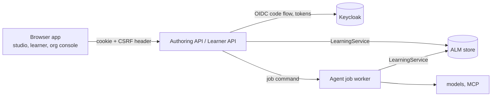

# Role applications: processes, modules and identity

This guide fixes the backend boundaries of the role applications described in the
[role-applications plan](../plans/role-applications-plan.md) and ordered by the
[prototype roadmap](../plans/prototype-roadmap.md). It applies owner defaults
D8–D10, approved with the roadmap (PR #73) and confirmed on 9 November 2026.

S03 builds the shared skeleton: `services/api_common` and an Authoring API
with health and identity routes. S05 adds the first read-only modules (see
[Read-only authoring endpoints](#read-only-authoring-endpoints-s05)); S06 adds
decisions and application (see [Review endpoints](#review-endpoints-s06)). S04 adds the front-end workspace in `apps/` and a studio
shell that signs in through the API (see [Front-end workspace](#front-end-workspace)); S07 adds the
studio review inbox, milestone M1 (see [Studio review inbox](#studio-review-inbox-s07)), and S07b a
read-only course overview (see [Studio course overview](#studio-course-overview-s07b)). S08 adds the agent job worker, its
jobs store and the `jobs` module (see [Agent jobs](#agent-jobs)). S12 adds the Learner API, a separate process (see
[Learner API](#learner-api-s12)). ALM remains the reference model. Nothing here changes
the ALM metamodel, the store schema or an AIM-PRO/jjodel export.

## Processes



| Process | Owns | Not allowed |
| --- | --- | --- |
| Authoring API (`services/authoring_api`) | staff sessions; projects, proposals, decisions, sources (from S05) | model credentials; direct store or decision internals |
| Learner API (`services/learner_api`, S12) | learner sessions; the learner's courses, course view and own progress (part 1); attempts and questions, the learner request as a job (part 2) | any authoring module (checked by `tests/services/test_learner_boundaries.py`) |
| Agent job worker (S08) | model calls, MCP retrieval, generators, orchestrator runs | serving browsers |

`LearningService` and its store own every write. An API process authorizes a
request against the trusted policy and calls the service; it never calls an
agent, a model, the database or MCP directly. A development profile may run
several processes in one Python process; the module boundaries stay the same.

## Agent jobs

Applications reach agents only through agent jobs (S08). A job is a typed command
that names exact input versions and a client `request_id`. The API authorizes it,
records it in the jobs store (D14: separate tables in a `jobs` schema, never the
ALM tables) and returns. The worker runs the existing service method. The result
is a pending proposal or a rejection with check codes; a person decides and
applies it through the decision endpoints. Job states: `QUEUED`, `RUNNING`,
`PROPOSED`, `REJECTED`, `FAILED`, `ABANDONED`; source jobs (S09a2, D22) add
`COMPLETED` (a discovery), `AWAITING_CHOICE` (a preparation: completed,
awaiting the teacher's choice) and the teacher's choice, `ACCEPTED` or
`DECLINED`. They propose nothing. A learner's question (S12, `learner-request`)
also ends `COMPLETED` and proposes nothing; it is queued by the Learner API
only (see [Learner API](#learner-api-s12)). Progress events are the
content-free events of `agent_system/events.py`. The ALM `request_id` stays the
idempotency key: a replayed `request_id` returns the same job.

### Implementation (S08)

`services/jobs` holds the jobs store, the job kinds and the worker; the
Authoring API imports only the first two, the Learner API only the store and
`services.jobs.learner`, the learner request job.

- **Jobs store** (`services/jobs/store.py`, D14). A SQLite location is a
  database file of its own, refused if it holds the ALM tables; a PostgreSQL
  location keeps its tables in the `jobs` schema. A job is named by its context
  and its `request_id`; the same command under the same id is the same job,
  another command (kind, command or subject) is a conflict. Status changes go
  one way (`QUEUED` → `RUNNING` → a final status; `QUEUED` or `RUNNING` →
  `ABANDONED`; `RUNNING` → `AWAITING_CHOICE` → `ACCEPTED` or `DECLINED`, and
  nothing else ends `AWAITING_CHOICE`) and each is recorded as a `status`
  event in the same transaction. Final: `PROPOSED`, `REJECTED`, `FAILED`,
  `ABANDONED`, `COMPLETED`, `ACCEPTED`, `DECLINED`; the run has ended in those
  and in `AWAITING_CHOICE`.
- **Job kinds** (`services/jobs/kinds.py`), named as the CLI commands they
  run: `generate-project-assessments`, `generate-project-teacher`,
  `generate-project-trainer` (a `GenerationCommand`) and
  `generate-aimpro-syllabus` (the Curator: an AIM-PRO export by file name and
  SHA-256 in the worker's `ALM_AIMPRO_EXPORTS` directory, the source scope, and
  a query or a prepared-sources request id). The worker refuses an export that
  is missing or differs from the named digest; it never writes the export.
  `revise-aimpro-syllabus` (S09b: the Curator's revision of a syllabus
  proposal, named by its id, after a revision request; no export, no search).
  Source kinds (S09a2), no model and no proposal:
  `discover-aimpro-syllabus-sources` (a `SourceDiscovery`: source scope and
  1–20 queries) and `prepare-aimpro-syllabus-sources` (an export and its
  `SourcePlan`, whose `source_sha256` must be the export's). `ask` (the learner
  request, S12) stays a CLI command.
- **Worker** (`services/jobs/worker.py`, `python -m services.jobs`). It claims
  the oldest queued job, opens its context with the trusted policy (D10),
  checks again that the subject may `propose`, and runs the existing service
  method inside an `agent_system.events` run bound to the job's event sink.
  Outcome: `PROPOSED` (the pending proposal is linked), `COMPLETED` (a
  discovery was recorded), `AWAITING_CHOICE` (a preparation was recorded),
  `REJECTED` (the host refused the command before any model; `detail` is the
  core's fixed message, never input text; also a Curator job naming prepared
  sources the teacher has not accepted), `FAILED` (generation did not complete, or an unexpected
  error, logged by type only), `ABANDONED`. A replayed `request_id` that the
  ALM store already answered (by a job or the CLI) returns that answer without
  building a model or searching again. It is the only process that loads model
  credentials and the document-search client: the production factories are the
  CLI's (`_aimpro_authoring`, `_aimpro_search`, `_aimpro_search_client`), built
  when a job needs them; the provider-call listener reports model calls as
  progress.
- **Event sink.** The run's events are validated by `agent_system.events`
  (identifiers, codes, counts and durations only) before they reach the sink;
  the sink keeps them in memory and records them in the jobs store, because the
  API runs in another process. Outside tests a refused event is dropped with a
  warning; tests use a strict sink, which makes it fail the run.

| Route | Who | Result |
| --- | --- | --- |
| `POST /contexts/{context_id}/jobs` (CSRF) | `propose` in the context | `JobView`, `QUEUED` or the existing job; 409 for another command under the same id |
| `GET /contexts/{context_id}/jobs` | `propose` | `JobList`: the context's jobs, newest first (`limit`, default 50, at most 200) |
| `GET /contexts/{context_id}/jobs/{request_id}` | `propose` | `JobView`; 404 for an unknown job |
| `GET /contexts/{context_id}/jobs/{request_id}/events` | `propose` | server-sent events until the final status (below) |
| `POST /contexts/{context_id}/jobs/{request_id}/abandonment` (CSRF) | administrator, as the CLI `abandon` | `JobView` `ABANDONED`; 409 once the job has ended, or while a running job's request is not reserved yet |
| `POST /contexts/{context_id}/jobs/{request_id}/choice` (CSRF) | `propose`, and the subject of the job | `SourceChoice` `{"choice": "ACCEPTED" \| "DECLINED"}` → `JobView`; the same choice again returns the job; 409 for another choice or a job not `AWAITING_CHOICE`; 403 for another subject |

Authorization is checked before a stream starts, so its errors are ordinary
JSON error bodies. The stream has two event names: `status`
(`{"status", "proposal_refs"}`) and `progress` (an `alm.event/1` record); each
event's `id` is its sequence, so a client reconnects with `Last-Event-ID`. A
stream ends once the run has ended (a final status or `AWAITING_CHOICE`), or after `ALM_API_JOB_STREAM_SECONDS`; it
reads new events every `ALM_API_JOB_POLL_SECONDS`. Neither the stream nor the
`detail` of a job carries a command, a prompt, a document or a learner's text;
`JobView` returns the command to the subjects who may propose in the context.

Abandonment: a queued job is marked `ABANDONED` and never started. A running
job whose worker was interrupted has its ALM request abandoned as the CLI
`abandon` does, then the job is marked `ABANDONED`; if the worker is still
running, its own write is refused and the job stays `ABANDONED`.

Run a worker next to the API (same `ALM_STORE`, `ALM_POLICY_DIR` and
`ALM_JOBS_STORE`):

```sh
export ALM_JOBS_STORE=/tmp/alm-seed/jobs.sqlite   # or a postgresql:// URL (schema "jobs")
export ALM_AIMPRO_EXPORTS=/path/to/exports         # optional: Curator jobs
python -m services.jobs            # --once runs at most one job; --poll SECONDS
```

The worker calls real models for the jobs it runs: start it only with the
owner's authorization for live runs. Tests use synthetic models only.

## Module rules

1. **One module, one router.** A module is an `ApiModule(name, router)` that
   declares its routes directly on its router. `ModuleRegistry` refuses duplicate
   names; `ALM_API_MODULES` selects modules by name (unset: all; empty: none).
   A module that is off has no routes.
2. **Reads and writes.** A read route depends on `current_principal`; a write
   route (`POST`, `PUT`, `PATCH`, `DELETE`) depends on `csrf_protected`.
   `create_app` refuses to build an app with a write route that lacks the CSRF
   check, and a module router that includes other routers (their routes could
   not be checked).
3. **No core internals.** Modules call `LearningService` and the read-only
   helpers it exposes. They never import `learning.store` or `learning.decisions`
   (checked by `ModuleBoundaryTest` in `tests/services/test_api_contexts.py`).
   When data is missing, a service method is added with tests first.
4. **Contracts.** Request and response models are Pydantic classes in the module,
   built from existing records; store rows are never exposed raw. The OpenAPI
   snapshot in `services/openapi/` is the contract:
   `python -m services.api_common.openapi --check` fails on drift and runs in CI;
   `python -m services.api_common.openapi` rewrites the snapshot for review. The
   snapshot contains every registered module, whatever a deployment selects.

## Errors and request ids

Every error has the body `{"error", "detail", "request_id"}`. The OpenAPI
snapshot documents that body (`ErrorBody`) for each error status of each route
(`error_responses` in `services/api_common/errors.py`), so the generated client
types error bodies correctly; FastAPI's default validation schema is not used.

| Cause | Status | `error` | `detail` |
| --- | --- | --- | --- |
| no session, expired session, failed login | 401 | `unauthenticated` | fixed text |
| `AuthorizationError` from `learning.policies.authorize`, unmapped identity, CSRF | 403 | `forbidden` | fixed text |
| `ContextUnavailable`: no such context, or its trusted policy is not installed (D10) | 404 | `context_unavailable` | `Context unavailable`; the reason is logged with the request id |
| `StateConflict` (reload, then retry) | 409 | `conflict` | the conflict message |
| request model, record (`ValidationError`) or core `ValueError` | 422 | `validation` | locations and messages; never input values |
| identity provider unreachable or not the configured issuer | 502 | `identity_provider_unavailable` | fixed text |
| anything else | 500 | `internal` | `Internal error`; the exception is logged with the request id |

`AuthorizationError` subclasses `ValueError`, so existing callers that catch
`ValueError` keep working. Role checks that raise a plain `ValueError` (for
example "Project authoring requires content authority") are still 422.

The `X-Request-ID` header is accepted when it matches
`[A-Za-z0-9][A-Za-z0-9._:-]{0,127}`, otherwise replaced by a new id; it is echoed
on every response and available to handlers through `current_request_id()`.
This is the correlation id of the HTTP request, for logs, events and traces. It
is not the ALM `request_id` of a command, which the client sends in the body.

## Identity

### Backend-for-frontend (D8)

The API is a confidential OIDC client. The browser never holds a token.

1. `GET /auth/login?return_to=/path` creates `state`, `nonce` and a PKCE verifier,
   keeps them server-side for `ALM_API_LOGIN_TTL` seconds (600), sets the
   `alm_login` cookie (the state; `HttpOnly`, `SameSite=Lax`, path `/auth`) and
   redirects to the provider with `code_challenge_method=S256`.
2. `GET /auth/callback` requires the `alm_login` cookie to equal `state`, uses the
   pending login once, exchanges the code with the verifier and the client
   secret, and checks the ID token: RS256 signature from the provider JWKS,
   issuer, audience (and `azp` when there are several audiences), `exp`, `iat`
   and `nonce`. Any failure is 401 and creates no session.
3. The identity is mapped (D9). Unmapped: 403, no session. Mapped: a random
   session id in the `alm_session` cookie (`HttpOnly`, `SameSite=Lax`, `Secure`
   unless `ALM_API_COOKIE_SECURE=false`, path `/`), valid for
   `ALM_API_SESSION_TTL` seconds (3600); redirect 303 to `return_to` when it is a
   local path, otherwise to `/`.
4. `GET /auth/session` returns `subject_key`, `csrf_token` and `expires_at`
   (`Cache-Control: no-store`). Writes send the token in `X-CSRF-Token`.
5. `POST /auth/logout` (CSRF required) ends the session and returns the
   provider `end_session_url` (with `id_token_hint` and the post-logout
   redirect), which the app opens to end the provider session.

Sessions, tokens and pending logins live in process memory
(`MemorySessionStore`): a restart signs everyone out, and one API process serves
each user. Tokens are not refreshed; the session ends at its lifetime.

### Identity map (D9)

A host-side file (`ALM_IDENTITY_MAP`) maps exact (issuer, `sub`) pairs to policy
subject keys:

```json
{"format": 1, "identities": [
  {"issuer": "http://127.0.0.1:58080/realms/alm-dev",
   "subject": "218842f7-8cad-4b90-96d7-c0540c4bb7f7", "subject_key": "admin"}]}
```

The map grants nothing. Provider roles and groups are ignored; what a subject may
do is decided by the trusted policy, as for the CLI `--subject`. A pair listed
twice, an unknown field or a subject key starting with `auto-` refuses the whole
file. The issuer is compared exactly, without URL normalization.

Since S12b (D9 revised, #141) a person of the configured issuer
(`ALM_OIDC_ISSUER`) who is not in the map signs in with an automatic subject
key: `auto-` and the first 20 hex digits of SHA-256 over the issuer and `sub`
(each length-prefixed), computed at every sign-in, so the same person always
gets the same key and nothing is written. A mapped person keeps their map key;
adding someone to the map later gives them the mapped key instead, with none of
the records of their automatic one. An automatic key grants nothing either: in
the studio such a person has no course and cannot create one; a learner gains a
course by joining it with its code (see [Enrolment](#teams-style-enrolment-s12b)).
No name or e-mail is kept: the staff see the key only.

### Policy resolution (D10, from S05)

A configured directory (`ALM_POLICY_DIR`) holds trusted policy files. For each
request the API reads the context's `policies` reference and loads the
`*.json` file whose `policy_ref` equals it exactly (`PolicyDirectory` in
`services/api_common/contexts.py`). No match means the context is unavailable
(404 `context_unavailable`); a context that does not exist gives the same
answer. Responses may reveal which contexts exist (D35, 16 November 2026,
removes the earlier rule that they never do). The directory is
read on every request: installing an approved policy preview stays a host
operator action, a file copy, and needs no restart. A file that is not a valid
trusted policy, or a `policy_ref` found in two files, refuses every resolution
(500, logged with the file name) instead of choosing one. Subdirectories and
other files are ignored.

A request reads one context, with one exception: a delivery import (S10) also
reads its authoring context, with that context's own installed policy, resolved
the same way (the `policies` resolver of `LearningService`). Its subject must be
authorized by both policies, at proposal and again at application; an authoring
context whose policy is not installed refuses the import (422).

Since S09a the API writes one kind of file there: the policy of a course created
from the studio (`POST /courses`, see "Course from an AIM-PRO model"). Since S11
(D25) it also writes a new version of a course's policy when its administrator
adds a member (`POST /contexts/{context_id}/members`, see "Course members"). Each
is a new file, written under a temporary name that no reader lists and then
linked to its name, so it appears whole or not at all; an existing file is never
replaced, changed or removed. Every other policy change, a delivery import's
preview included, stays an operator action.

## Configuration

| Variable | Meaning |
| --- | --- |
| `ALM_OIDC_ISSUER` | exact issuer; discovery must report the same value |
| `ALM_OIDC_CLIENT_ID`, `ALM_OIDC_CLIENT_SECRET` | confidential client |
| `ALM_OIDC_REDIRECT_URI` | this API's `/auth/callback`, registered at the provider |
| `ALM_OIDC_POST_LOGOUT_REDIRECT_URI` | optional; registered at the provider |
| `ALM_IDENTITY_MAP` | path of the identity map |
| `ALM_API_COOKIE_SECURE` | `true` by default; `false` only for local HTTP |
| `ALM_API_SESSION_TTL`, `ALM_API_LOGIN_TTL` | seconds; defaults 3600 and 600 |
| `ALM_API_MODULES` | comma-separated module names; unset selects all |
| `ALM_STORE` | ALM store: an existing SQLite file or a `postgresql://` URL (kept secret: it may hold a password); required when any authoring or learner module is selected |
| `ALM_POLICY_DIR` | directory of trusted policy files (D10); required with `ALM_STORE` |
| `ALM_JOBS_STORE` | jobs store (D14): a SQLite file, created if missing and never the ALM database, or a `postgresql://` URL (schema `jobs`); required when the `jobs` module (Authoring API) or the `questions` module (Learner API) is selected |
| `ALM_API_JOB_POLL_SECONDS`, `ALM_API_JOB_STREAM_SECONDS` | progress stream: seconds between reads (default 1) and lifetime before the client reconnects (default 300) |
| `ALM_COURSE_TEMPLATE` | course template (S09a): who may create courses and the source scopes of a new course; read on every request, never written; required when the `courses` module is selected |
| `ALM_AIMPRO_EXPORTS` | directory of uploaded AIM-PRO exports, the one the worker reads; must exist; required when the `exports` module is selected |
| `ALM_API_EXPORT_MAX_BYTES` | largest accepted upload, in bytes (default 10485760, 10 MiB) |
| `ALM_ENROLMENT_SECRET` | host secret the course codes are derived from (S12b), at least 32 characters; required when the `enrolment` module (Authoring API) or the `enrolments` module (Learner API) is selected; both APIs need the same value, and changing it changes every course's code |

`ALM_API_MODULES=` (empty) runs the identity routes alone, without a store. The
API never creates a SQLite database: a missing file refuses to start.

## Read-only authoring endpoints (S05)

Four modules, each one router, all reads (`GET`, a session, no CSRF). Each
response is a record the CLI already prints, so every endpoint has a parity
test with its CLI command on the same seeded database
(`tests/services/test_authoring_read_api.py`). Responses carry
`Cache-Control: no-store`.

| Module | Route | Response | CLI equivalent |
| --- | --- | --- | --- |
| `contexts` | `GET /contexts/{context_id}` | `ContextSummary`: context, visible entities, findings | `show` |
| `review` | `GET /contexts/{context_id}/pending-proposals` | `PendingProposals`: newest first, each with the proposal, its exact candidates and `review_payload_key` | `show` (proposals `AWAITING_DECISION`) and the preview `decide` prints before `CONFIRM` |
| `projects` | `GET /contexts/{context_id}/projects/{project_id}` | `ProjectInspection` | `show-authoring-project` |
| `projects` | `GET /contexts/{context_id}/resources/{resource_id}/versions/{version}/project-syllabus` | `ApprovedSyllabus` of that exact current project revision | `show-project-syllabus` |
| `releases` | `GET /contexts/{context_id}/resources/{resource_id}/versions/{version}/release` | `ReleaseInspection` | `show-release` |

- **One store and policy per request.** `ContextServices.open` opens the store,
  resolves the policy (D10) and builds a `LearningService` with it inside the
  route function, then closes the store. The service's orchestrator factory
  refuses: the API never builds agents.
- **Redaction.** A learner-only subject gets exactly what `show` gives it: the
  context as it is now, its own participant record and its own learning
  records; its pending proposal list is empty. Since S12 the context lists only
  the subject's own participant, occurrences and learning states, and earlier
  revisions of the context (reachable from the learner's own records, and
  listing other learners) are left out. Project and release reads need the `propose` action
  and content authority, as in the CLI.
- **No writes.** The table digests of the store (row count and SHA-256 per
  table, as the copy tool computes them) are unchanged after every endpoint,
  for every subject, including refusals.
- **Review key.** `review_payload_key` is `learning.decisions.review_payload_key`
  over the proposal and its candidates, the key `decide` records. A decision
  sends it back (S06).
- Exact references in paths: `resource_id` and `version` name one `Resource`;
  identifiers with `:` are sent percent-encoded.

## Review endpoints (S06)

Two writes in the `review` module. Both need a session and the CSRF token
(`X-CSRF-Token`, D8) through `context_writer`, resolve the context as the reads
do (404 `context_unavailable`), answer `Cache-Control: no-store` and return the
entity the CLI prints.

| Route | Body | Response | CLI equivalent |
| --- | --- | --- | --- |
| `POST /contexts/{context_id}/decisions` | `DecisionRequest`: `target` (exact `EntityRef`), `decision` (`APPROVE`, `REJECT`, `REQUEST_REVISION`), `reason`, `review_payload_key` | the `HumanDecision` | `decide` after `CONFIRM` |
| `POST /contexts/{context_id}/applications` | `ApplicationRequest`: `proposal` (`EntityRef`), `operation_id` | the `StateChange` | `apply --operation-id` |

- **Stale review → 409.** `LearningService.decide(..., expected_key=...)` refuses
  with `StateConflict` when the key differs from the key of `target`, or when
  `target` is no longer the latest revision of that record (for example another
  reviewer decided after the inbox was loaded). The key ignores `status` and
  `decision`, so a decision alone never changes it; the revision check is what
  catches a concurrent decision. The client reloads and reviews again; a
  decision on the reloaded revision is allowed (a revocation).
  Nothing is written before the check.
- **One write transaction.** `decide` now runs the context load, the checks and
  the writes in one write transaction, so the payload that was checked is the
  payload that is decided.
- **The CLI follows the same rule.** CLI `decide` passes the key of the payload
  it printed before `CONFIRM` as `expected_key`. If another reviewer decides
  while the CLI waits, or the reference is an earlier revision, the CLI records
  nothing and exits 2; a revocation names the current revision. Only callers of
  `LearningService.decide` without a key (tests, fixtures) keep the earlier
  rule, where a decision on an earlier revision is recorded.
- **Applied proposals.** A decision on an `APPLIED` proposal is still recorded
  and changes its status, not the applied change (owner, 9 November 2026).
- **Replay.** `apply` is the core `apply_proposal`: the same `operation_id`
  returns the stored `StateChange` without writing; the same id for another
  proposal is 409. A proposal that is not approved is 422, as the CLI exits 2.
- **Authority unchanged.** The core checks the `decide` and `apply` actions
  (403) and the reviewer roles: administrative authority for `Participant` and
  `PolicySet`, assessment authority for `Evaluation`, content authority for the
  other kinds (422, plain `ValueError`).
- **Interchangeable with the CLI.** A decision recorded by one is applied by the
  other, and an application replays across both with the same operation id
  (`tests/services/test_authoring_review_api.py`, on SQLite and PostgreSQL).

## Synthetic seed (D15)

`python -m tests.seed --output DIR [--db LOCATION]` builds a development
database through the production commands; only model and retrieval responses are
synthetic (the fixtures of `tests/authoring_cycle_fixtures.py`). No model or
network is used. `DIR` must be new or empty and receives `alm.sqlite` (unless
`--db`; a PostgreSQL URL is never written to disk), `policies/` (the installed
trusted policy), `policy-previews/` (the delivery import's preview, not
installed) and `seed.json` (contexts, subjects, exact references).

| Context | State |
| --- | --- |
| `architecture-authoring` | applied syllabus, project, assessment, teacher and trainer content, completion rules and release; one pending Evaluator revision |
| `architecture-delivery` | the applied import of that release; its policy is the preview, so it is unavailable until the preview is copied into `policies/` |
| `architecture-delivery-2` | a pending import of the same release; `learner` and `learner-2` are participants |

The subjects are `admin` (administrator, content responsible, assessor),
`learner` and `learner-2` (S12: both are learners of both deliveries, so a
learner's reads are checked against another learner's records). `admin` and
`learner` are subject keys of the dev identity map; `learner-2` is not mapped
there yet. The map also holds
`assessor`, who is in no policy of the seed: a course administrator adds them
as a member (D25).

`python -m tests.seed --output DIR --attempt [--db LOCATION]` records the
learner's synthetic attempt at the assessment of `architecture-delivery`
through `submit` (S11, dev only). An attempt is learner history, which
activation refuses, so it is a separate step: the delivery's policy must be
installed in `policies/` and the delivery active. The same attempt is recorded
once. `--learner learner-2` records the second learner's attempt, under its own
request id.

## Front-end workspace

`apps/` is an npm workspace (D12) with exact versions in `apps/package-lock.json`;
Node 22.22 or later.

| Workspace | Content |
| --- | --- |
| `packages/api-client` | `src/generated/authoring.ts`, generated by `openapi-typescript` from `services/openapi/authoring.json`; `createAuthoringClient` (`openapi-fetch`, same-origin credentials, `no-store`). Front-end modules reach the API only through it |
| `packages/ui` | design tokens (`tokens.css`), base styles, `AppShell` (skip link, banner, main), `Button`, `StatusMessage`. Components carry no text of their own; colour pairs are tested against WCAG 2.1 AA contrast |
| `packages/auth` | `createSessionApi` (`/auth/session`, `/auth/logout` with `X-CSRF-Token`), `loginUrl`, `SessionProvider` and `useSession`. The CSRF token stays in memory; nothing is written to browser storage |
| `studio` | React app served under `/studio/`: sign-in, signed-in subject, sign-out, not-found page, and the review inbox (S07, `src/features/review/`). Routes in `src/routes.tsx`, one folder per feature in `src/features/` |
| `e2e` | Playwright browser tests (D12) with axe checks, on the synthetic seed and the local Keycloak; not a workspace |

Commands, run in `apps/`:

| Command | Effect |
| --- | --- |
| `npm ci --ignore-scripts` | install from the lockfile |
| `npm run generate:client` | rewrite the generated client after the snapshot changes |
| `npm run check:client` | exit 1 when the client differs from the snapshot (CI) |
| `npm run typecheck`, `npm test`, `npm run build` | TypeScript, Vitest (all workspaces), studio build in `studio/dist` |
| `npm run test:browser` | Playwright browser tests in `e2e/` (see [Browser tests](#browser-tests)) |

The CI job `front-end` runs `check:client`, `typecheck`, `test` and `build`; the
CI job `browser` runs `test:browser`. An API change is therefore two steps:
`python -m services.api_common.openapi` rewrites the snapshot, then
`npm run generate:client` rewrites the client; both are reviewed in the PR.

**Strings.** Every visible string is in a JSON catalogue (`studio/src/i18n/en.json`)
read through `i18next`; translation keys are type-checked against it. The test
`apps/tests/user-visible-strings.test.ts` fails when a component under
`packages/*/src` or `studio/src` contains JSX text with a letter, a string
literal as a JSX child, or a literal `aria-label`, `title`, `alt`, `placeholder`
or `label`. A new language is one more catalogue.

**Serving.** The dev realm registers the callback and the post-logout page on
`127.0.0.1:58000`. In development the studio's Vite server (`npm run dev`, or
`npm run preview` for the build) listens there and forwards `/auth`,
`/health` and `/contexts` to the API on `ALM_STUDIO_API_URL` (default `http://127.0.0.1:58001`),
so the browser sees one origin and the session cookie stays same-site. `/`
redirects to `/studio/`. How a shared deployment serves the built studio (API
or reverse proxy) is part of D17.

## Studio review inbox (S07)

Milestone M1: a reviewer completes a review in the browser. The studio uses the
S05 and S06 endpoints only; nothing in the API, the core or the store changed.

| Page | Path under `/studio/` | Reads | Writes |
| --- | --- | --- | --- |
| Home | `/` | `GET /contexts` | `POST /courses` |
| Review inbox | `/contexts/{context_id}/review` | `GET /contexts/{context_id}`, `GET …/pending-proposals` | — |
| Proposal | `/contexts/{context_id}/review/{proposal_id}` | the same two reads | `POST …/decisions`, `POST …/applications` |

- **Inbox.** Two lists: proposals `AWAITING_DECISION` (from `pending-proposals`,
  newest first) and proposals `APPROVED` but not applied (from the context
  summary, which holds the latest revision of each proposal). A pending
  assessment is named "Proposed assessment: " plus the first line of its
  activity instruction, with the number of points to check; other entries show
  the first sentence of the proposal's `proposedChange`.
- **Course list (D35, 16 November 2026).** The home page lists the courses of
  the signed-in subject (`GET /contexts`): every context whose installed policy
  grants the subject `read` in it, by id, with its mode, status and the
  subject's roles in words. Each course opens its course page or its review
  inbox; no context id is typed. A context whose policy is not installed is
  unavailable and is not listed.
- **Teacher view first (owner validation, 9 November 2026).** The first version
  showed the data model (field paths, versions, hashes, structure records); the
  owner found it incomprehensible for a teacher. The proposal page now leads
  with the teaching content of the candidates (`teacher.ts`, `TeacherView.tsx`):
  - *What changes*: sentences computed from the teaching records only
    (`ActivityDefinition` instruction and evidence, `Rubric` criteria by key,
    `AssessmentSpecification` conditions and accepted evidence,
    `ResourceRequirement` purpose, conditions and required/optional), compared
    with the applied record of the same type and id; a change of links or
    versions alone is "the teaching content is the same". On the seed the only
    sentence is "Assessment condition added: “Explain two prompting choices.”";
  - *What students would be asked to do*, *How it would be assessed* (rubric as
    criteria and levels, conditions), *Learning outcomes covered* (statements,
    not ids), *Resources the activity needs*;
  - *To check before deciding*: the generator report and the findings as
    sentences, grouped by where the problem is: the generated content (shown),
    the course and its source material (closed, with a count: the proposal does
    not cause them), and the generator's notes.
  Teacher and trainer content (S09c2) also show *Material for students*: the
  title and text of each material, and a changed text side by side with the
  one in use. Completion rules show *When each part counts as completed*: each
  part of the design, from the root, with its rule. The title names the kind
  (assessment, teacher content, trainer content, completion rules), read from
  the role of the generated package or the rules among the candidates.
  Proposals without teaching records (project initialization, release,
  import) show their summary sentence instead; their views are S09c2 part 2.
- **Technical details, closed.** Identifiers and versions, the review payload
  key, the raw diagnostics (proposal findings, context findings, the generator
  report as lists and tables), the field-by-field diff of every candidate
  against the applied record (each differing leaf by path, for example
  `criteria[1].description`) and the exact payload. The decision covers exactly
  this payload.
- **Decision.** Approve, reject or request a revision, with a reason (both
  required, checked before any request). The request carries the exact revision
  shown and its `review_payload_key`. After any answer the page reloads both
  reads; nothing of the previous read is shown while it reloads.
- **Conflict.** A 409 (another reviewer decided after the page was loaded) shows
  "This proposal changed after you opened it…" and the reloaded state; the
  decision form is offered only while the proposal awaits a decision.
- **Apply, a separate step.** Shown only when the latest revision is
  `APPROVED`. The operation id is a random UUID created once per approved
  revision and kept in memory for the life of the page (`OperationIds`), so a
  retry after a request without an answer sends the same id and the API replays
  the change. Without an answer the page does not reload and offers the retry; a
  409 or 422 (for example an approval revoked meanwhile, Chat 14 finding 3)
  shows the core's message and reloads.
- **Session.** Writes send the CSRF token of the session (memory only). A 401
  returns the shell to sign-in. Nothing is written to browser storage.
- **Scope left out.** Revoking a decision from the browser, a list of contexts,
  and decisions on `ResourceBinding` or `Evaluation` records are not part of
  S07; the CLI still does them.

## Studio course overview (S07b)

Added on the owner's request of 9 November 2026, after validating S07: the
review inbox alone showed no picture of the course. A read-only page
`/studio/contexts/{context_id}/course` built from the same two reads as the
inbox (`GET /contexts/{context_id}` and `GET …/pending-proposals`); no API,
core or store change. `src/features/course/course.ts` (pure) follows the
references of the context summary by type and id (the summary holds the latest
revision of each record):

| Section | From |
| --- | --- |
| Name, status, mode | the context's `learningDesign` and its own `status` and `mode` |
| Structure | the design's `root` `ProcessNode` tree: phases and units in order, each with its activities (intent, format, instruction, evidence), teaching strategies and completion rule condition; a node that refers back to an ancestor is not followed again |
| Learning outcomes and competences | the design's `outcomes` and the `Topic`s they name |
| Teaching strategies | the design's `strategies` |
| Assessments | the design's `assessmentSpecs`: activity, rubric (criteria and levels), conditions, accepted evidence |
| Materials | `Resource`s whose content is plain text (teaching material); a locator (`http(s)://…`) is a cited source; a JSON package or manifest is left out |
| History | every `ChangeProposal`, newest first, with its `HumanDecision`s (when, who, verdict, reason) and its `StateChange`; pending and approved ones link to the proposal page |

The home page opens the course ("Open the course") or the inbox; the course
page links to the inbox with the number of pending proposals, and the inbox
links back. A subject that cannot see the learning design (a learner, by the
summary's redaction) gets "The course content of this context is not visible
to you."

### Browser tests

`apps/e2e/` holds Playwright tests (Chromium) with axe checks (`@axe-core/playwright`,
WCAG 2.1 A and AA rules). `npm run test:browser` in `apps/`:

1. starts the API (`e2e/stack/api.mjs`): removes `e2e/.state/`, builds the
   synthetic seed there with `python -m tests.seed`, keeps a copy of its
   database, writes a course template (creator `admin`, source scope `wp3`) and
   an empty export directory, and runs `python -m services.authoring_api --port 58001`
   against the local realm, next to the dev-only synthetic worker
   (`python -m tests.synthetic_worker`) and the Learner API
   (`python -m services.learner_api --port 58002`, client `alm-learner-api`,
   started first; S12b); the Python is `ALM_PYTHON`, else
   `.venv/bin/python`, else `python3`;
2. builds the studio and serves it with `vite preview` on `127.0.0.1:58000`;
3. signs in once as `dev-admin`, `dev-learner` and `dev-assessor` through Keycloak and keeps the session cookies;
4. restores the seed database before each test, removes every policy file an
   earlier test wrote (course policies, an installed delivery preview, member
   versions; only the seed's own policy stays) and deletes the jobs of the jobs database
   (`e2e/.state/jobs.sqlite`, kept open by the worker); tests run one at a time.

Ports already in use fail the run (no reuse of another process). The tests need
Keycloak running (`compose.identity.yml`) and the same `ALM_KEYCLOAK_DEV_PASSWORD`
and `ALM_OIDC_CLIENT_SECRET` it was started with. The CLI (`python -m learning`) is
used on the same database to play "another reviewer" and to check what the
browser recorded.

| Test | Checks |
| --- | --- |
| `review.spec.ts`: reviews and applies the Evaluator proposal | inbox → proposal; the teacher view (one change, the activity, the rubric, the outcome, the points to check) and the technical details; approve, then apply; the CLI `show` lists one decision with the reviewed key and one `StateChange` whose `newVersion` is the context version |
| `review.spec.ts`: decided by another reviewer after loading | the CLI rejects while the page is open; the browser's approval gets 409, the page reloads and shows "Rejected"; only the CLI decision exists |
| `review.spec.ts`: lost application answer | the first application reaches the API but its answer is dropped; the retry sends the same operation id; one `StateChange` exists |
| `course.spec.ts`: the whole seeded course | every section shows the seed's content (unit, three activities, completion, outcome and competence, strategy, rubric, four materials and the cited source, history with one pending proposal); no request other than `GET`; the SHA-256 of the database file is unchanged; axe; navigation to the inbox and back |
| `course.spec.ts`: as a learner | `dev-learner` on `architecture-delivery-2` sees only the not-visible message; axe |
| `build.spec.ts`: a course from an uploaded AIM-PRO model | create a course (one new policy file next to the seed's); upload the AIM-PRO export the fixtures use: the stored file has the uploaded bytes and digest; the Curator job with the synthetic model ends with a link to the proposal; approve and apply the syllabus; the course page shows the structure; propose, approve and apply the project; the build page shows the project; axe on the build page with every disclosure open |
| `build.spec.ts`: a syllabus on accepted sources (S09a2) | upload; search with two queries (synthetic retrieval); the excerpt found by both, with its usage conditions; tick it, write its purpose and limitations, prepare; the prepared sources; axe with every disclosure open; no prepared sources offered to the Curator before the choice; accept; the Curator on the accepted sources ends with a proposal; approve and apply; the course structure; back on the build page, the three jobs listed with their status; axe |
| `refinement.spec.ts`: a syllabus refined step by step (S09b) | upload; the Curator by a query; the syllabus in words (competency, practice, planned activities) compared with a course without a syllabus, and not the generic "same teaching content" sentence; axe; a revision request with its reason (with the synthetic reviewer's marker, so its first draft is rejected); "Ask the Curator for a revised syllabus" ends with a link to the revision; the review agent's assessments of the two drafts (rejected, then accepted, its reason labelled as model text); axe; compared with the previous proposal (title changed, one unit changed in its purpose, one unit added) and showing the reason; axe; approve and apply: the course shows the revised syllabus; the teacher edits it (syllabus title, a unit title; axe on the form): a new proposal by the teacher, compared with the syllabus in use; approve and apply: the course shows the teacher's syllabus, "Edited by"; axe |
| `generation.spec.ts`: the review of an Evaluator job's drafts (S09c, S09d) | on the seed's authoring context, an Evaluator job queued through the API with the browser's session (no form before S09c2), its requirement holding the synthetic reviewer's marker; the job list shows it proposed with "Blocks of units written: 1 of 1"; "How the review agent judged the drafts of this job": block 1 draft 1 not accepted ("Content complete: no", its reason labelled as model text), block 1 draft 2 accepted, the assembled draft accepted; the job view does not hold the reason; axe |
| `teacher-views.spec.ts`: every proposal kind in words (S09c2, part 2) | on the seed, every proposal of the authoring context and the delivery imports of both delivery contexts, pending or decided, opened by URL: each has its title (syllabus, project initialization, assessments, teacher and trainer content, completion rules, release, delivery import; never "Proposed change"), the initialization says what it creates, the release lists its parts by kind, the import names its resources and agents, a decided proposal shows no comparison; axe on each; the course page links decided proposals with "Read this proposal" |
| `cycle.spec.ts`: the rest of the authoring cycle (S09c2) | a new course: upload, Curator, approve and apply the syllabus, initialize and apply the project; the Evaluator form shows the project and course version it sends (read back through the API), the Teacher form says it needs the assessments; axe; another author applies an Evaluator proposal through the API, so the form's job is refused at queue time (409): the form says the course changed and shows the new course version; the Evaluator queued again, its proposal read in its teacher view (rubric; axe), approved and applied; the Teacher form shows the applied assessment it sends; the Teacher and Trainer proposals read with their material texts (axe), approved and applied; the completion rules proposed from the build page, read part by part (axe), approved and applied; the project inspection lists the five artifacts with their receipts and no stale dependency, and every node of the design has a rule |
| `release.spec.ts`: a release and its delivery course (S10, part 1) | on the seed's authoring context, the build page's release step shows the project model it sends; the release proposed from it, read in its teacher view (its parts; axe), approved and applied; "Inspect this release": nothing stands in the way, seven approvals (the release, its project and five parts), what it freezes, no problem; axe; a delivery course created from the release page opens on the import of that release, its policy file names the creator on that course only, and it is in PREPARATION/DRAFT without a model; axe; the course page lists both releases, and the seeded one inspects with nothing in the way |
| `assessment.spec.ts`: two members in one proposal (S11b) | a new course; `assessor` as Assessor and `learner` as Observer proposed together; the review names both (axe); approved and applied: both members, nothing pending, nobody left to add |
| `enrolment.spec.ts`: joining with the code (S12b) | the seed's opened delivery installed and activated in the studio; the members page creates the code and shows it with the join link (axe); `dev-unmapped`, in a browser of their own, signs in to the Learner API with an `auto-` key and joins with the code alone (typed in capitals with spaces), twice with one result, and then has the course; the administrator sees them as Student, adds `assessor` as a student at once (no proposal listed), resets the code (the old one gets 404) and disables it |
| `delivery.spec.ts`: a release imported and its activation refused (S10, part 2) | a course created from the home page; on the seeded release page its id is refused as the delivery course, in words, and the page stays (#132); a delivery course created; the import form proposes, for each of the seven requirements, the resource the release pins; axe; the first set to "No resource": "6 of 7"; the import proposed with six resources and its policy preview shown in full, naming the new course; no policy file installed; its teacher view lists six resources and the same preview; axe; approved and applied: the course is unavailable and no policy file was written; the test, as operator, installs the preview; on the course page, activation proposed and refused in words (the unbound requirement, R08; no runtime-role refusal since S11); axe; the course is still PREPARATION/DRAFT with six bindings |
| `assessment.spec.ts`: an assessor evaluates the seeded attempt (S11) | the test, as operator, installs the seeded delivery's preview; `dev-admin` proposes `assessor` as Observer from the members page, then, while it is pending, as Assessor: both listed under the warning (axe); reads the second as a new member, approves and applies it; the members page lists the first as made on an earlier version; proposes activation; after a reload the course page shows the pending activation with its link and no button; approves and applies it (LEARNING/ACTIVE); the seed records the learner's synthetic attempt (`--attempt`); `dev-assessor`, in their own session, follows "Evaluate the students' submitted attempts" to the one attempt (axe), chooses Formative and asks for a draft; the synthetic worker's runtime assessor proposes it; the draft read in words (the agent `learner-response-evaluator`, the response, one criterion, the result; axe); no learning state before; approved and applied by the assessor: one learning state, one formative evaluation with its human decision |
| `build.spec.ts`: a syllabus not accepted (issue #112) | upload; the Curator by a query holding the synthetic reviewer's `REJECT_EVERY` marker ends with a proposal; the job list shows the fixed notice; axe; the syllabus view says the review agent accepted no draft, with its reason as model text; axe; approve and apply; the course shows the structure |
| `build.spec.ts`: an invalid file | a text file is refused with "The file is not UTF-8 JSON"; no report; the export directory and the database file are unchanged; axe |
| `accessibility.spec.ts` | axe on the home page (also with its validation error), the inbox with and without pending proposals, the proposal page with every disclosure open, its validation errors, the apply step, a refused application, and an unavailable context |

```sh
export ALM_KEYCLOAK_ADMIN_PASSWORD=$(openssl rand -hex 16) ALM_KEYCLOAK_DEV_PASSWORD=$(openssl rand -hex 16)
export ALM_OIDC_CLIENT_SECRET=$(openssl rand -hex 24)
docker compose -f compose.identity.yml up -d --wait
cd apps && npm ci --ignore-scripts && npx playwright install chromium && npm run test:browser
```

## Course from an AIM-PRO model (S09a)

A teacher creates a course, uploads an AIM-PRO model, lets the Curator draft the
syllabus, reviews it and initializes the project, all from the studio. Owner
decisions of 9 November 2026 (issue #97): the API writes the new course's
policy; uploads are stored in the worker's export directory; a file that does
not fit the generated contracts is accepted with its findings; source
preparation as a job is a later step.

### Creating a course: module `courses`

`POST /courses` with `{"context_id"}` (lowercase letters, digits and inner
hyphens, at most 64) creates a context in PREPARATION/DRAFT with a policy of its
own. The course template (`ALM_COURSE_TEMPLATE`) is installed by an operator:

```json
{"format": 1, "creators": ["admin"], "source_scopes": {"wp3": ["wp3"]}}
```

- Only a subject key listed in `creators` may create a course (403 otherwise,
  also without the CSRF token). Keycloak roles still grant nothing (D9).
- The API writes `course-<id>-1.json` in `ALM_POLICY_DIR` with `policy_ref`
  `PolicySet course:<id>` version 1. The creator is its only subject, with the
  roles `ADMINISTRATOR` and `CONTENT_RESPONSIBLE` and the actions `read`,
  `bootstrap`, `propose`, `decide`, `apply` and `interact` in that context only;
  each template scope becomes a scope of that context and creator with the
  template's sources. Then the context is bootstrapped as the CLI `bootstrap`
  does, with that policy.
- An id that a context uses, or that an installed policy names (in a grant, a
  scope or its `policy_ref`), is a 409 and writes nothing. A different file
  already under the course's file name is a 409 and stays as it is.
- The same request again returns the same `CourseView` (`context_id`,
  `policy_ref`) and writes nothing; it also completes a creation that stopped
  after the policy file was written. `created` tells the two apart: `true` when
  this request created the course, `false` when it returns an existing one
  (S11b, #132). The release page refuses an existing course as the delivery
  course, in words ("You already have a course with this id. A delivery course
  needs a new id."), and does not navigate; the home page opens it, as before.
- Not in S09a: adding other teachers or learners (since S11, "Course members"
  below), and changing or revoking a course policy from the studio.

### Course members: module `members` (D25, S11; batch, D36, S11b)

The owner decided D25 on 16 November 2026 (issue #129): a member joins a course
through a new version of its trusted policy written by the API. The owner decided
D36 on 17 November 2026 (issue #133): one proposal may add several members, and
a pending membership proposal does not refuse another; the studio shows the
pending ones and warns (S11b, issue #138).

- `GET /contexts/{context_id}/members`, for an administrator of the course only
  (403 otherwise): the members (`subject`, their `roles` in this course, from
  the context's `Participant` records), the subject keys of the identity map
  that are not members yet (`addable`), and the roles that may be granted.
- `POST /contexts/{context_id}/members` with `request_id`, `base_context` and
  `members`, one or more `{subject, role}`, by an administrator of the course
  with the CSRF token. Every subject must be in the identity map (422 naming the
  others); the role is one of `CONTENT_RESPONSIBLE`, `ASSESSOR` (both: `read`,
  `propose`, `decide`, `apply`, `interact`) or `OBSERVER` (`read`);
  `ADMINISTRATOR` cannot be granted, and `LEARNER` (`read`, `interact`,
  `submit`) is no longer proposed through the API: students are added at once
  (S12b, "Teams-style enrolment" below). A subject
  named twice, or one who already takes part, refuses the whole proposal (422).
  The answer names the proposal, each member's `Participant` (`participants`)
  and the new policy. API version 0.16.0 (S11b; the request held one `subject`
  and `role` before).
- The command (`learning/membership.py`) copies the installed policy as one new
  version: each member's grant for this context (a subject that the policy
  already names in other contexts keeps those grants), and each member added to
  every scope of this context alone, so a learner of an imported delivery reads
  its bound resources. The API installs it as `<policy id>-<version>.json`
  before the proposal is recorded; a failure leaves at most an unused file. The
  CLI `propose-membership --base-context REF --member SUBJECT:ROLE ...
  --request-id ID --policy-file NEW` writes it to a new file instead; the
  proposal is applied with that file passed as `--other-policy`. A membership
  recorded before S11b, with one `subject` and `role`, reads as one member.
- The proposal holds each member's `Participant`, the new `PolicySet` version
  (its permissions end with the canonical new policy) and the context with only
  `participants` and `policies` changed. An administrator decides and applies
  it; until then no member has authority. Application rechecks that exactly
  that policy is installed. The same request id returns the same proposal; a
  different command under it (other members, or the same in another order) is
  a 409.
- Every membership proposal starts from the installed policy and the course
  version of its time: once one is applied, the others pending in the course
  are refused as stale when applied, and nothing is lost (D36). The core does
  not refuse a proposal while another is pending.
- A generic proposal cannot record a membership policy (a `PolicySet` with a new
  membership entry), and in an imported delivery it still cannot move
  `policies`. In an imported delivery the command works in PREPARATION and
  ACTIVE, and activation accepts a membership version derived from the reviewed
  import preview.
- Studio: the course page of an administrator links "Members of this course"
  (`/contexts/{context_id}/members`): the members with their roles in words; the
  membership proposals not applied yet (awaiting a decision, with their members,
  or approved), each with its link and whether it was made on an earlier
  version of the course, under the warning that one is applied at a time; and a
  role to choose for each person who may join, all proposed in one proposal.
  The review page describes the proposal as its new members. Removing a member
  is not offered.
- Studio, activation (#133): the activation section of a delivery course in
  preparation shows an activation proposal not applied yet (awaiting a decision,
  or approved) made on the course as it is now, with its link, instead of
  "Propose activation"; one made on an earlier version can no longer be
  applied, so activation is offered again. The studio reads both from the
  course summary's `ChangeProposal` records (`candidateDefinitions`,
  `baseContextVersion`) and the pending proposals.

### Uploading the model: module `exports`

`POST /contexts/{context_id}/aimpro-exports?scenario=&competencies=&root_id=`
takes the file as the request body (`application/octet-stream`). The subject
needs `propose` in the context, checked before the body is read. The checks, in
order, each with its 422 reason:

| Check | Reason |
| --- | --- |
| a body | `The file is empty` |
| at most `ALM_API_EXPORT_MAX_BYTES` (also from `Content-Length`) | `The file is larger than N bytes` |
| UTF-8 JSON | `The file is not UTF-8 JSON` |
| `format` `jjodel-megamodel`, `formatVersion` `1.0` | `The file is not a jjodel megamodel export, format 1.0` |
| its metamodels load (`aimpro.contracts.Contracts`) | `The metamodels of the export cannot be read` |
| the scenario and competency catalogue resolve (`aimpro.validation.validate_scenario`; defaults `SCN01`, `elena_usecase_competencies`) | `The scenario and the competency catalogue cannot be resolved in the export` |

While checked, the bytes sit under a hidden temporary name in the export
directory that no job can name; a refused file leaves nothing there, in the ALM
store or in the jobs store. An accepted file is linked, unchanged, to
`<sha256>.json`; the same file again is kept as it is, other bytes under that
name are a 409. The `ExportReport` gives the `AimproExport` (name and SHA-256)
for the Curator job, the size, project id, root, number of objects, whether the
scenario conforms to the generated contracts, and its `source_diagnostics` and
`contract_findings`. Findings do not refuse a file; they also reach the syllabus
proposal, whose teacher view shows them in plain words.

### Syllabus and project: module `projects`

| Route | Body | Response | CLI equivalent |
| --- | --- | --- | --- |
| `GET /contexts/{context_id}/designs/{design_id}/versions/{version}/syllabus` | | `ApprovedSyllabus` of the context's current Curator outline | `show-aimpro-syllabus` |
| `POST /contexts/{context_id}/projects` | `ProjectInitializationRequest`: `request_id`, `project_id`, exact `syllabus` and `base_context` | `ProjectProposal`: a pending proposal; the same request id replays it | `init-authoring-project` |

A subject outside the context gets 403 from both routes, as from the CLI. The Curator itself runs as the S08 job
`generate-aimpro-syllabus`, grounded by a query, on the uploaded export.

### Studio

- The home page has "Create a course"; it opens the new course's build page.
- `/studio/contexts/{context_id}/build` ("Build the course"), from
  `src/features/course-build/`: (1) upload the model, with the report and its
  diagnostics as sentences; (2) ask the Curator with a source scope and a
  query: the page follows the job (`GET …/jobs/{request_id}` every second) and
  links to the proposal once it is `PROPOSED`, or says why the job ended;
  (3) once a syllabus is applied, propose the project from the approved
  syllabus of the current outline and link to its proposal. Projects already
  selected (the `authoring-project` manifests of the context's domain models)
  are listed instead of the form. A retry after a lost answer reuses the
  step's request id.
- The course page links to the build page; a course without a design shows
  "This course has no syllabus yet." to its author or administrator, and the
  not-visible message to anybody else.

### Synthetic worker (dev only)

`python -m tests.synthetic_worker [--once] [--poll SECONDS]` is the worker of
S08 with the synthetic models of `tests/services/job_fixtures.py`: same job
store, kinds and outcomes, no model, provider or network. It needs
`ALM_STORE`, `ALM_POLICY_DIR`, `ALM_JOBS_STORE` and `ALM_AIMPRO_EXPORTS`. The
browser tests run it; it is for UI development only, never for real data.

## Source preparation as a job (S09a2)

A teacher has the sources of a course prepared, reviews them and decides
whether the Curator uses them (D22). Owner decisions of 10 November 2026
(issue #101): two jobs, a discovery and then a preparation, because a source
plan names exact excerpts that a teacher cannot know before searching; the
teacher's acceptance is recorded in the jobs store; a minimal job list; and
coverage requirements entered from the uploaded export's targets.

1. **Discovery** (`discover-aimpro-syllabus-sources`, core
   `discover_sources`, CLI of the same name with `--discovery FILE`). The
   worker runs each query in the PREPARATION scope and records a
   `SOURCE_DISCOVERY` (every excerpt found, per query, with the unique and
   repeated hits) in the host requests store under the request id. Authority,
   scope and a PREPARATION/DRAFT context are checked before the client is
   built; a replay returns the record without a new search; a failed search is
   recorded as a failure with a fixed text. No model, no entity, no proposal.
2. **Preparation** (`prepare-aimpro-syllabus-sources`, unchanged core). The
   studio builds the `SourcePlan`: the discovery's queries, the excerpts the
   teacher ticked (exact ids and SHA-256) with the purpose and the limitations
   the teacher wrote, `min_resources` and `max_documents_per_resource` set to
   the distribution picked, and the optional coverage requirements. The worker
   runs the queries again, fetches the exact excerpts and records the
   `SOURCE_PREPARATION`; the job ends `AWAITING_CHOICE`.
3. **Choice.** The teacher who prepared the sources accepts or declines them,
   once (`POST …/jobs/{request_id}/choice`).
4. **Curator.** A `generate-aimpro-syllabus` job with `prepared_sources` is
   refused with 409 by the API, and `REJECTED` by the worker before any model,
   unless the jobs store holds a preparation job under that request id, of the
   same subject, `ACCEPTED`: "The prepared sources have not been accepted by
   the teacher". A preparation recorded only by the CLI, awaiting the choice
   or declined is never used by a job. The CLI `generate-aimpro-syllabus
   --prepared-sources` is an operator path and does not consult the jobs store.

### Reading what the worker recorded: module `sources`, and the export targets

| Route | Who | Response |
| --- | --- | --- |
| `GET /contexts/{context_id}/source-discoveries/{request_id}` | `propose`, content authority, the subject who ran it | `SourceDiscoveryView`: scope, queries, each excerpt once (resource, version, document id, SHA-256, title, URI, licence, corpus licence verdict, exact text, the queries that found it), unique and repeated hits |
| `GET /contexts/{context_id}/source-preparations/{request_id}` | the same | `SourcePreparationView`: the plan's scope, export SHA-256, queries, limits and coverage requirements; each excerpt with its exact text, licence and verdict, purpose and limitations |
| `GET /contexts/{context_id}/aimpro-exports/{sha256}/targets?scenario=&competencies=&root_id=` (module `exports`) | `propose` | `ExportTargets`: the learning targets of a stored export with their practices and the texts a coverage requirement may quote (`description`, `inPractice`, `rationale`, `contextDetails`) |

An unknown id, a failed request, another kind or another subject's record is a
404. The licence and the verdict are the corpus's metadata (`licence`,
`licence_verdict`); the studio shows them as usage conditions, not as an
approval.

### Studio

The build page (`src/features/course-build/`) now has, in order: the current
syllabus; **Jobs of this course** (`JobsList`: kind and status in words, the
reason of a job that ended, a link to a proposal, and "Pick excerpts from this
search" or "Review and choose these sources" for the teacher's own jobs; read
when the page opens and on "Reload the list"); 1. upload; **2. Prepare the
sources (optional)** (`SourcesStep`: scope, queries and excerpts per query;
the excerpts found with their usage conditions and text; a tick, a purpose and
limitations per excerpt; optional coverage requirements chosen from the
export's targets, practices and field texts, each quote checked against the
text; then the prepared sources and "Accept these sources" or "Decline
them"); 3. the Curator, which works from "Sources I accepted" (the export,
scenario and scope of the preparation) or "A search query"; 4. the project.
Each queued job is followed every second until its run has ended.

## Syllabus refinement (S09b)

A teacher refines the syllabus step by step (D18). The Curator's output and the
teacher's edits stay proposals that a human decides and applies. Owner
decisions of 10 November 2026 (issue #104):

1. **Units are paired by learning target.** Two syllabi are compared unit by
   unit on `source_target_id`; units on the same target are paired in their
   order; the extra units are added or removed (`aimpro/syllabus_compare.py`).
   The unit key is not used: the Curator does not keep it between generations.
2. **The Curator holds the conversation.** A revision request
   (`REQUEST_REVISION`, which leaves the proposal `DRAFT`) is one turn: the job
   `revise-aimpro-syllabus` gives the Curator the previous syllabus and the
   reasons of the whole chain, first to last, as data of its prompt
   (`AIMPRO_SYLLABUS_REVISION`, `previous_syllabus`, `teacher_reasons`). Its
   result is reviewed by the review agent as any generated syllabus.
3. **A manual edit is complete** (every field; units added, removed and
   reordered) and passes **the same checks** as a generated syllabus
   (`checked_syllabus`). It is recorded as a proposal by the teacher, without a
   model, declared "edited by the teacher, not reviewed by the agent"; the
   teacher may approve and apply it.
4. **A refinement reuses the input of the proposal it refines** (the source
   snapshot with its prepared or retrieved excerpts): nothing is searched or
   prepared again. The course must still be at that proposal's step: its base
   version, or the version its application produced; otherwise "The course
   changed after this syllabus proposal; prepare the sources and generate the
   syllabus again" (a fixed `ReviewError`).

The syllabus payload (`SyllabusArtifact`, format version 1) gains optional
fields, omitted when absent so that earlier payloads keep their exact shape:
`revises` (the `ChangeProposal` it refines), `revision_reasons` and
`edited_by`; `review` is absent exactly when `edited_by` is set. The resolver
of an applied syllabus checks the review only when there is one.

### Module `syllabus`

| Route | Who | Response |
| --- | --- | --- |
| `GET /contexts/{context_id}/syllabus-proposals/{proposal_id}` | a subject who is not learner-only | `SyllabusProposalView`: the proposal's syllabus (status, responsible, draft, review or `edited_by`, revision reasons); the texts of its targets (statement, competencies by name, practices with how they work) and of every excerpt it may cite (text, licence, and the purpose and limitations of prepared sources); the proposal it refines and the comparison with it; the course design (`NONE`, `SYLLABUS`, `OTHER`), the applied syllabus and the comparison with it |
| `POST /contexts/{context_id}/syllabus-edits` (CSRF) | `propose`, content authority | `SyllabusEdit` `{request_id, proposal, draft}` → `EditedSyllabus` `{proposal}`; the same request again returns the same proposal; a refused check is a 422 with its fixed text; 404 for a proposal without a syllabus |
| `GET /contexts/{context_id}/syllabus-reviews/{request_id}` (Chat 20) | `propose`, the subject who ran the request | `SyllabusReviews` `{request_id, outcome, attempts}`: each Curator draft of an ended syllabus request (by a query, by prepared sources, or a revision), first to last, with the review agent's verdict (`verdict`, `source_alignment`, `citation_support`, `reason`) or the fixed text of the check that refused it; 404 for an unknown or unended request, another kind or another subject |

A revision is queued as a job (`POST …/jobs`, kind `revise-aimpro-syllabus`,
`{"proposal": id}`); the worker rejects it before any model without a revision
request on the latest revision of the proposal, or when the course has moved.

### Studio

- **Proposal page.** A proposal whose records include a syllabus payload shows
  "Proposed syllabus": the units in words, the revision requests that led to
  it, what it leaves open, "What the revision changes" or "What the edit
  changes" (units with their status and, for a changed unit, each changed field
  before and after), and "Compared with the syllabus of the course". The
  generic teacher view is not shown for it. After a revision request, "Ask the
  Curator for a revised syllabus" queues the revision job, follows it and links
  to the new proposal; a revision job already started for the proposal is shown
  again. "Edit this syllabus yourself" opens the editor.
- **Editor** (`…/review/{proposal}/edit`): the syllabus title and what it
  leaves open; per unit its title, purpose, learning target (the competencies
  follow the target), planned activities, practices of the target and cited
  excerpts with what they support; add, remove and move units and citations.
  "Propose this syllabus" sends the whole syllabus and opens the new proposal.
- **Course overview.** The structure section shows the syllabus in use: title,
  "Edited by" for a teacher's syllabus, and each unit's purpose and planned
  activities.

### The review agent's assessment of each draft (Chat 20)

Owner decisions of 10 November 2026 (issue #107), after most real Curator
attempts were refused by the review agent without the teacher seeing why:

1. **At most three drafts per request** (`aimpro.syllabus.ATTEMPTS`). A draft
   refused by the deterministic checks (`checked_syllabus`, the coverage
   checks included) or not accepted by the review agent (`REJECT`,
   `UNCERTAIN`, or a flag false) goes back to the Curator with
   `AIMPRO_SYLLABUS_RETRY`: its draft (`rejected_syllabus`) and why
   (`review_feedback`: the verdict, itself model output, or the fixed check
   text), as untrusted data. The review agent judges each draft on its own and
   never sees an earlier verdict. A review over the budget or not a verdict
   stops at once.
2. **When the drafts run out, the request fails as before**, with the fixed
   text of the last refusal; a generated syllabus still always carries an
   `ACCEPT` review, and `SyllabusVerdict` is unchanged. *Changed by issue
   #112 (below): the last draft that passed the checks is proposed.*
3. **Every draft's assessment is kept with the request's result** in the ALM
   requests store (`SyllabusResult`: a `LearningResponse` with `attempts`,
   omitted when empty), for a proposal and for a failure; a replay returns
   it. The review agent's `reason` is model text: it is shown to the teacher,
   labelled, and never becomes an error message, the job `detail`, a log line
   or an event. Each draft emits one content-free `review` event (`stage`
   `SYLLABUS` or `SYLLABUS_CHECKS`, `attempt`, `verdict` and the two flags).
4. **The review of a revision receives the revision context**:
   `previous_syllabus` and `teacher_reasons` as untrusted data, with
   `AIMPRO_SYLLABUS_REVISION_REVIEW`, which asks it to check every rule and
   that the draft does what the reasons ask. The review prompt of a generation
   is unchanged.
5. **The prepared-sources path reports the fixed `ReviewError` text**, as the
   query and revision paths do ("Selected-source authoring did not complete
   (…)"). Other errors keep only their type.
6. **The review prompt was calibrated on live verdicts** (owner-authorized
   runs, handoff `docs/plans/handoffs/chat-20.md`), in three clauses only:
   source diagnostics and a non-conforming source are named as unresolved but
   are not by themselves grounds for `REJECT`, `UNCERTAIN` or a false
   `source_alignment`; retrieved excerpts that no unit cites are not grounds
   for rejection; each `supported_claim` is judged as worded, so a claim
   limited to what its excerpt states (a general principle whose transfer the
   draft declares as a gap) is supported.

In the studio, an ended Curator job of the signed-in teacher (`PROPOSED` or
`FAILED`) offers "How the review agent judged the Curator's drafts" in the job
list and in the revision step; it is read when opened. Each draft shows how it
ended, the two checks of the review agent in words and its assessment as
"The review agent's assessment (model text): “…”", or the check that refused
it.

### Host-set competencies, citable excerpts and syllabi not accepted (issue #112)

Owner decisions of 11 November 2026, after a live Curator job on LPO AI (48
targets) failed at the checks three times (handoff
`docs/plans/handoffs/chat-21.md`, "Live run on LPO AI"):

1. **The host sets each unit's competencies from its target**
   (`aimpro.syllabus.with_target_competencies`), after each Curator response and
   before the checks: the export determines them, so the model no longer copies
   them. A unit whose target is unknown keeps what the Curator wrote and is
   refused by the checks. A teacher's edit is checked as before.
2. **Citations.** The Curator request holds `citable_excerpts` (each retrieved
   resource id, version and excerpt ids), and the prompt asks it to cite only
   those. A draft with citations outside them is refused with the same fixed
   text; the check (`CheckRefusal`) also names every offending unit and citation,
   and the retry receives them as `check_details`, untrusted data, never as an
   error message.
3. **A syllabus no draft of which was accepted is still proposed.** When the
   drafts run out, the last draft that passed the checks is proposed with its
   verdict (`SyllabusArtifact.review` may now be `REJECT` or `UNCERTAIN`), for
   the teacher to approve, revise or edit. The result carries the fixed
   `NOT_ACCEPTED` notice (`SyllabusResult.notice`), which the worker sets as the
   job's `detail`; the review agent's reason stays model text. If no draft
   passed the checks, or the review stopped, the request fails as before. This
   applies to the three Curator paths (by a query, on prepared sources, a
   revision); the Evaluator, Teacher and Trainer are unchanged.

In the studio the syllabus view says "Generated by the Curator, but the review
agent accepted none of its drafts…", with the reason labelled as model text.
The synthetic reviewer refuses every review prompt holding `REJECT_EVERY`
(dev only), used by `build.spec.ts`.

## Evaluator, Teacher and Trainer drafts (S09c)

Owner decisions of 10 and 11 November 2026 (issue #110). S09c was split: this
part changes the project generators; the studio forms, the teacher view of every
proposal kind and the completion rules follow in S09c2.

1. **The generators take a whole syllabus.** Units and items of
   `AssessmentDraft`, `TeacherDraft`, `TrainerDraft` and
   `StructuredTeacherDraft` (and its explanations, comparisons, peers and
   transcripts) go from 24 to `aimpro.syllabus.UNITS` (96), the units of a
   syllabus; materials go from 96 to `aimpro.teacher_contracts.MATERIALS`
   (3 × 96: a Teacher item needs an explanation, a transcript and an
   example). `DidacticDraft` (the earlier `generate-aimpro` path, not used by
   the studio) keeps 24. A 48-unit synthetic syllabus reaches the three
   proposals; whether a live model writes that much in one response is not
   measured.
2. **D30 applies to the generators.** At most three drafts per request
   (`aimpro.generators.ATTEMPTS`). A draft refused by `checked_draft` (and,
   for a structured Teacher, by its rendering) or not accepted by the review
   agent (`REJECT`, `UNCERTAIN`, or one of the four flags false) goes back to
   the generator with `PROJECT_AUTHORING_RETRY`: its own output
   (`rejected_draft`) and why (`review_feedback`), as untrusted data. The
   review agent judges each draft on its own. A draft that is not the typed
   contract, a context over the budget or a review that is not a verdict stops
   at once; the drafts judged before it are kept. A recorded Teacher response
   (`--recorded`) is the first draft; a retry asks the model.
3. **When the drafts run out, the request fails as before**, now with the
   fixed `ReviewError` text: "Authoring generation did not complete (Authoring
   output did not pass separate Lead review); no accepted proposal was
   persisted." Other errors keep only their type. A generated proposal always
   carries an `ACCEPT` review.
4. **Every draft's assessment is kept with the request's result**
   (`GenerationResult`: a `LearningResponse` with `attempts`, omitted when
   empty) and read with `GET
   /contexts/{context_id}/generation-reviews/{request_id}` (`propose`, the
   subject who ran the request; `GenerationReviews` `{request_id, outcome,
   attempts}`; 404 for an unknown or unended request, another kind or another
   subject). The review agent's `reason` never becomes an error message, the
   job `detail`, a log line or an event; each draft emits one content-free
   `review` event (`stage` `PROJECT` or `PROJECT_CHECKS`, `role`, `attempt`,
   `verdict` and the four flags). The review prompts are not calibrated in
   this step.

In the studio, an ended Evaluator, Teacher or Trainer job of the signed-in
teacher offers "How the review agent judged the drafts of this job" in the job
list, read when opened: each draft, how it ended, the four checks in words and
the reason as model text, or the check that refused it.

## Generator forms and completion rules (S09c2, part 1)

Owner decisions of 11 November 2026 (issue #115): S09c2 is two PRs. This part
adds the generator forms, the completion rules and the teacher views of the
proposals they produce; part 2 adds the views of project initialization,
release and delivery import, and the teacher view of proposals that are no
longer pending. Chat 21 trial finding 1 stays open with D28.

1. **The build page runs the rest of the cycle.** Once the project is
   initialized it shows, in order, the Evaluator, Teacher and Trainer forms
   and the completion rules. Each form shows what it sends: the project
   (`Resource` id and version, from `GET /contexts/{id}/projects/{project_id}`),
   the course version (the context's current ref) and, for the Teacher and
   Trainer, the applied assessments (the project's `ASSESSMENT` selections),
   with optional requirements, one per line. The Teacher and Trainer forms
   need an applied assessment. A command gets a new request id when what it
   sends changes; a retry of the same command returns the same job.
2. **A stale base is refused at queue time.** `POST /contexts/{id}/jobs` refuses
   an Evaluator, Teacher or Trainer command whose `base_context` is not the
   context's current version with 409 "The course has changed since this form
   was read; reload it", and records nothing; a request id already queued
   returns its job. The form then reads the course again (keeping what it
   showed, with sending disabled, until the new read arrives) and says so.
3. **Completion rules are a host command with one fixed rule.**
   `CompletionRules` (`learning.projects`), `LearningService.propose_completion_rules`,
   the CLI `propose-completion-rules --project --base-context --request-id` and
   `POST /contexts/{context_id}/completion-rules` (`{request_id, project,
   base_context}` → `ProjectProposal`) put `COMPLETION_RULE` ("complete this
   process node only when every direct child is COMPLETED"; process completion
   only, never a grade or a verification) on every process node of the
   project's current design, over its direct children and activities, as
   `RuleDefinition` `completion-rule:<node id>`. The proposal is a project
   revision: the Trainer content is selected again at a new version with
   unchanged fields (a revision selects at least one artifact, and nothing
   depends on the Trainer content), with the new nodes and design. It is
   refused (422) without Trainer content, and (409) on a stale base or when the
   Trainer content is stale. A request id replays. The test fixture
   `ProductionAuthoring.configure_completion` now uses this command; the
   handlers of a delivery import bind the `completion-rule:` rules.
4. **API version 0.10.0** (one route added).

The build page lists content made from an earlier version of what it depends
on (the project's stale dependencies) and asks for it to be generated again
before the completion rules.

## Generation by blocks of units (S09d)

Owner decisions of 12 November 2026 (issue #118). In the owner's trial of
11 November one Evaluator response for 48 units reached the wall-clock
deadline of a model call (`[llm] timeout = 600`) while still writing. The
Evaluator, Teacher and Trainer now write a request in several responses.

1. **Blocks of 12 target units.** `aimpro.generators.BLOCK_UNITS = 12`. The
   request's target units are cut, in order, into consecutive blocks; a
   48-unit syllabus is four. Each block is a `GenerationInput` with a
   `UnitBlock` (`index`, `count`, `unit_keys`) that restricts its
   `target_units`; the request's own input has no block and keeps its exact
   shape and digest. A block is named by its units only (`unit_keys`), not by
   its place among the blocks. The generator of block N receives the full input, its own
   units (`PROJECT_AUTHORING_BLOCK`) and, as `previous_blocks`, the accepted
   drafts of blocks 1..N-1, as untrusted data. The structured Teacher and the
   Curator are unchanged: one response.
2. **Each block is reviewed under D30, then the assembled draft once.** A block
   draft passes `checked_draft` for its units, and its material keys must not
   repeat those of an earlier block ("Material keys must be unique across
   blocks"); the review agent judges it with the full input and that block only
   (`PROJECT_AUTHORING_BLOCK_REVIEW`), with up to three drafts per block. The
   accepted blocks are assembled (units in order, materials, gaps without
   repeats) into one draft over the request's input, which passes
   `checked_draft` and is judged once by the review agent with the usual
   prompt, also when there is one block. One proposal per job, carrying the
   final verdict.
   A draft that does not write each requested unit once, in syllabus order, is
   refused in words the author can read, naming the units by their position in
   the syllabus (owner decision of 13 November 2026), for example "The draft
   must cover each unit it was asked to write once, in the order of the
   syllabus: units 14 and 15 of the syllabus are missing; 1 unit it was not
   asked to write was added."; the retry receives the expected, missing and
   unexpected unit keys as `check_details` (data). The generator still receives
   the whole syllabus.
3. **A flow ends with something for the teacher to decide** (owner, 13
   November 2026; this changes D30 for these generators, the structured
   Teacher keeps it). A block whose checked drafts the review agent accepts
   none of keeps its last checked draft (`block` event `KEPT`), and a final
   review that is not `ACCEPT` does not stop the job: the assembled draft is
   proposed with its verdict and the fixed notice `NOT_ACCEPTED` ("The review
   agent did not accept every block or the assembled draft; the last drafts
   that passed the checks are proposed with its assessments, for the teacher to
   decide."), which is the job's detail, as for the Curator since issue #112.
   A block whose three drafts all fail the checks is written in two halves; a
   block of one unit that fails them fails the job.
   **A job that fails keeps its accepted blocks.** Each accepted block is recorded once in the
   ALM requests store (`learning.generation.KeptBlocks`, request id
   `generation-block:<sha256>` of the block's input digest, the subject and
   the drafts of the blocks before it; operation `PROJECT_GENERATE_BLOCK`), so
   a new job with the same command on the same exact inputs reuses it without
   a model call, after checking it again. Any change applied to the course
   changes the base context, and so every block's input.
4. **Every attempt names its block.** `GenerationAttempt` gains `block`,
   `final` (the review of the assembled draft) and `reused` (a block accepted
   by an earlier job), each omitted when unset, so attempts recorded before
   S09d keep their shape; `GET …/generation-reviews/{request_id}` returns them.
5. **A block whose response does not fit is written in two halves**, down to
   one unit (owner, 13 November 2026: the approach must not depend on the
   model). The deadline interceptor raises
   `agent_system.deadline.DeadlineExceeded`, and the OpenAI SDK raises
   `LengthFinishReasonError` for a response cut at its output length limit;
   when a call of a block (a draft or its review) ends with either, whatever
   the SDK wraps it in, the block's units are written as two smaller blocks
   instead (the attempt has `timed_out` or `truncated` and the fixed text
   `SPLIT` or `CUT_SPLIT`), and every later block of the request takes the
   smaller size too: the request learns how much the model writes in one
   response (a block split by the checks changes no other block). Only a block of one unit that does not fit stops
   the request, with `TIMED_OUT` ("Authoring generation did not complete (A
   model call reached its time limit); no accepted proposal was persisted.")
   or `CUT` ("The model's response was cut at its length limit"). The
   provider's message is never shown or logged. The deadline
   of a model call (`runtime.properties` `[llm] timeout`) is 1200 s (was 600,
   owner decision of 13 November 2026).
6. **Content-free progress.** One `block` event per block (`role`, `block`,
   `blocks`, `outcome` `ACCEPTED`, `REUSED`, `KEPT`, `SPLIT`, `NOT_ACCEPTED`,
   `TIMED_OUT` or `CUT`; `blocks` grows when a block is split); `review` events
   of a block carry `block`, and the final review has stage `PROJECT_FINAL`.
   `JobView.blocks` (`{written, count}`, or `null`) counts the blocks written so
   far from those events. API version 0.11.0.

In the studio, the job list shows "Blocks of units written: 2 of 4", and "How
the review agent judged the drafts of this job" names each draft's block, a
block reused from an earlier job, a call that reached the time limit, a
response cut at its length limit and the review of the assembled draft (labels
and data only).

## Teacher views of every proposal kind (S09c2, part 2)

Issue #121; acceptance agreed with the owner in Chat 21 and split in Chat 22.

1. **One proposal, whatever its status.** `GET
   /contexts/{context_id}/proposals/{proposal_id}` returns the latest revision
   of the proposal with its candidates and its review payload key
   (`PendingProposal`), authorized as `pending-proposals`: a subject that may
   not see the pending proposals reads none (the same status), and an unknown
   proposal is 404. API version 0.12.0.
2. **Every kind has a view in words.** The studio reads the candidates of a
   proposal that no longer awaits a decision through that route, and builds the
   teacher view for every kind:
   - *project initialization* ("Start the authoring project of the course"):
     what it is, why it is approved (it records the exact parts the next steps
     build on; students see nothing new), the parts it selects and the kinds
     still to prepare (Chat 22 trial finding 3);
   - *release* ("Freeze the course as a release"): the parts it freezes, by
     their kind in the project, and that nothing reaches students before an
     import;
   - *delivery import* ("Bring a release into a delivery course"): its units,
     the resource each requirement uses, the agents that help students, the
     sources the course may use, and the activities; it is no longer titled as
     completion rules (its candidates carry them).
3. **A decided proposal shows what it carries.** "What changes" compares a
   proposal with the course only while it can still be decided or applied
   (awaiting a decision, approved, or in revision); an applied or rejected one
   shows its content without the comparison.
4. **Generated content the review agent did not accept says so** (S09d): its
   view opens with "The review agent did not accept this content. Its
   assessment (model text): “…”. You decide whether to approve it.", from the
   verdict kept in its package.
5. The course page links every proposal: "Review this proposal" while it can be
   decided or applied, "Read this proposal" after (labels and data only).

## Release and delivery course from the studio (S10, part 1)

Issue #123; owner decisions of 15 November 2026 (the delivery course is created
from the studio; two PRs) and 16 November 2026 (each context keeps its own
policy, below).

1. **A release is proposed from the studio.** `POST /contexts/{context_id}/releases`
   does what the CLI `propose-release` does: the exact selected project, its
   domain model and the base context, with the ALM request id (the same id
   replays the same proposal); a stale base is 409 and a refusal 422. API
   version 0.13.0. The build page's step "9. Release" sends the project of the
   inspection, the course's model of that project (the `DomainModel`
   `<project id>:model` among the context's models) and the course version, and
   says first which parts are missing or out of date. The proposal is read in
   its teacher view (S09c2), decided and applied through the review endpoints.
2. **An applied release is inspected.** The page
   `/contexts/{context_id}/releases/{release id}/versions/{version}` reads
   `show-release` (`GET …/resources/{id}/versions/{version}/release`, S05) and
   says whether anything stands in the way of delivering the release; who
   approved the release, its project and each part (with a link to each
   proposal, or "no approval of this exact version was found"); the exact
   records it freezes, by type; and each finding with its reason and what to
   do. The course page lists the releases of its release catalogue, first to
   last, and an applied release proposal links to its page.
3. **The delivery course is created from the release page**, with `POST /courses`
   unchanged (D23): a new course in PREPARATION/DRAFT with its own policy for
   its creator, and the template's source scopes as any course. The form is
   offered only for a release with no finding; since part 2 the new course
   opens on the import of that release.
4. **Each context keeps its own policy** (owner, 16 November 2026), implemented
   in part 2, below.

## Delivery import and activation from the studio (S10, part 2)

Issue #123; owner decisions of 15 November 2026 (bindings proposed and
changeable; activation proposed and refused in words) and 16 November 2026 (each
context keeps its own policy; the list of each requirement is the resource the
release pins, or none).

1. **Each context keeps its own trusted policy.** The import reads the authoring
   context with the authoring context's installed policy, found by its exact
   reference as D10 finds a request's policy; the subject must be authorized by
   the delivery context's policy (to propose there) and by the authoring
   context's (to read and propose there, with content authority). The
   application rechecks both under its write lock: a policy changed or removed
   in between refuses it. In the core, `LearningService` takes a `policies`
   resolver (the API passes `PolicyDirectory.find`) and `RunContext` carries it;
   without one, only the context's own policy is known, so the seed's shared
   policy works as before. The CLI takes `--other-policy FILE` (repeatable) for
   the same purpose.
2. **What an import binds is read from the release.** `show-release` (and its
   API route) now also lists, once the release has no finding, each
   `ResourceRequirement` of the frozen design with the exact resource the
   release pins for it (`_pins`) and its title, and the completion rules of the
   design's parts.
3. **The import.** `POST /contexts/{context_id}/delivery-imports` does what
   `propose-delivery-import` does (`DeliveryImport` plus `request_id`; the
   result `ImportProposal` holds the policy preview); `POST
   /contexts/{context_id}/activations` does what `propose-activation` does, and
   answers `ActivationOutcome`: the proposal, or, when refused, the findings and
   no proposal, with nothing recorded (status 200: the refusal is the answer,
   not an error). API version 0.14.0.
4. **The import page** `/contexts/{delivery}/import?from={authoring}&release={id}&version={version}`
   lists each requirement ("Requirement n: purpose") with a list holding the
   resource the release pins, proposed, and "No resource"; the core accepts no
   other resource (owner, 16 November 2026). It says how many requirements get
   a resource and how many completion rules the design has; each is bound to
   `all_completed`, the condition of the fixed completion rule (S09c2). The
   scope is `{delivery}:delivery`. The exact selection is sent; a retry of the
   same selection reuses its request id. A course that already holds a
   configuration, or a release with findings, gets no form.
5. **The policy preview is shown in full**, on the import page after the
   proposal and in the import's teacher view (read from the proposed
   `PolicySet`), with a file name for the operator
   (`{policy id with - for :}-{version}.json`) and a link that downloads that
   exact file. Neither the studio nor approval
   installs it, and it never replaces the installed file: an operator copies
   the exact reviewed preview into `ALM_POLICY_DIR` as a new file. Until then
   the applied course names a policy that is not installed and is unavailable
   (404): the proposal page says so after the application, with no link to the
   course.
6. **Activation.** The course page of an imported delivery course in
   PREPARATION says it is a delivery course, offers no build link, and has a
   section "Activation". "Propose activation" shows the refusal in words: each
   finding with its reason, what to do and its code. An accepted activation
   links to its proposal. Since S11 an assessment no longer refuses it: the
   import configures the runtime assessor.
7. **Who may import.** The import's scope grants the delivery course's
   participants, which is its creator only (D25 open).

## Runtime assessor from the studio (S11)

Issue #129; owner decisions of 16 November 2026 (D4 lifted by option A; D25 = A;
decisions 1–8). The core is described in
[the release guide](releases.md#runtime-assessor-s11).

1. **The job.** `POST /contexts/{context_id}/jobs` takes the kind
   `propose-evaluation` with `command: {evidence, mode}` (an observed
   `LearningEvidence` and `FORMATIVE` or `FORMAL`). It is queued only by a
   subject who may `propose` and holds `ASSESSOR` in the course (403
   otherwise). The worker runs `LearningService.propose_evaluation` with the
   runtime assessor its resources hold (`Resources.assessor`; the production
   worker builds `learner-response-evaluator`, the synthetic worker answers
   with the highest level of each criterion). Its outcome is `PROPOSED` with
   the evaluation proposal, `REJECTED` with the core's fixed reason (no attempt,
   not an assessment, no active delivery, no assessment authority), or `FAILED`
   with the fixed text after three failing drafts. API version 0.15.0 (S11).
2. **The page** `/contexts/{context_id}/assessments`, linked from the course
   page of an active delivery for a participant with the `ASSESSOR` role
   ("Evaluate the students' submitted attempts"). It lists the observed
   attempts at ASSESS activities, read from the course summary: the student,
   the assessment's first line, when, the response, and the evaluations
   already applied. For each, the assessor chooses the kind of evaluation
   (Formative or Formal; nothing is preselected) and asks the assessor agent
   for a draft; the job is followed until it ends, then the page links the
   draft or gives the job's fixed reason. A retry of the same choice reuses its
   request id until that job has ended; asking again then starts a new draft.
3. **The draft in words.** The review page titles an evaluation proposal
   "Evaluate a student's attempt" and shows who drafted it (the agent's
   registry name) and in which mode, the assessment and the student, the
   response, each criterion of the rubric with the level given and its
   descriptor (or "not determined") and the agent's reason, and the result.
   The decision and the application are the usual ones; the requester may
   decide.

## Learner API (S12)

Issue #136; owner decisions of 17 November 2026 (D19 for now, D20 and its
projection, the `show` gap closed here). A separate process,
`python -m services.learner_api [--port 58002]`, built by
`services.learner_api.app.create_app` on the shared skeleton: the same identity
routes, error shape, request ids, policy directory and settings as the Authoring
API (`ALM_API_MODULES` selects its modules; `ALM_STORE` and `ALM_POLICY_DIR` are
required with any of them). Its OpenAPI snapshot is
`services/openapi/learner.json`, checked by the same `--check`; version 0.2.0
with part 2, 0.3.0 with joining (S12b). Every response is `Cache-Control:
no-store`; every read leaves the table digests of the store unchanged. The
writes need the CSRF header, as the Authoring API's writes do; the module
`questions` also needs `ALM_JOBS_STORE`, and `enrolments` needs
`ALM_ENROLMENT_SECRET`.

| Module | Route | Response |
| --- | --- | --- |
| `courses` | `GET /courses` | `CourseList`: the courses the subject is enrolled in as a learner, each with its context id and the name of its learning design |
| `courses` | `GET /courses/{context_id}` | `CourseView`: the validated course of the delivery (D20) |
| `progress` | `GET /courses/{context_id}/progress` | `OwnProgress`: the learner's own records |
| `attempts` | `POST /courses/{context_id}/attempts` | `Evidence`: the learner's attempt at an activity, recorded once under the learner's own request id |
| `questions` | `POST /courses/{context_id}/questions` | `QuestionView`: a question to the Teacher or the Socratic coach, queued as a job |
| `questions` | `GET /courses/{context_id}/questions` | `QuestionList`: the learner's own questions in the course, newest first |
| `questions` | `GET /courses/{context_id}/questions/{request_id}` | `QuestionView`: one of them, with the response once its run has ended |
| `enrolments` | `POST /enrolments` | `LearnerCourse`: the course the subject joined with its code (S12b) |

- **My courses (D19, D37).** `learning.learner.enrolled_courses` is the one
  source of the list, reached through `ContextServices.enrolled`: the LEARNING
  contexts with status ACTIVE whose participants include the subject as
  `LEARNER` and whose installed policy grants the subject `LEARNER` and `read`
  there, by name or by the delivery's learner grant to a participant who is only
  a learner (S12b). A membership not applied yet changes neither, so its member
  is not listed.
- **Course view (D20).** A projection of named fields from the active model of
  the delivery, which is the release it imported, never a draft or a proposal:
  the syllabus structure (phases and units in order, each with its activities:
  instruction, intent, format, expected evidence, outcomes, strategies,
  materials and assessment), the outcomes with their competences (the ALM
  topics they address, as the studio shows them), the teaching strategies, the
  materials (the resources bound by a valid, approved binding in a scope the
  learner may read: the same check as readiness) and each assessment with its
  activities, outcomes, conditions, accepted evidence and rubric criteria and
  levels. Never the answer key; no proposal, decision, participant or learner
  record is named.
- **Own progress.** The learner's own occurrences, evidence, applied
  evaluations (the assessment, mode, each criterion's level and reason, the
  result) and learning states. Records are matched to the learner's own
  participant whatever the subject's other roles. An evaluation is listed once
  a person applied it: a pending draft is only a candidate of its proposal.
- **Who.** A subject who holds `LEARNER` in the policy and in its participant
  record, in a LEARNING/ACTIVE delivery. Anyone else is refused: 403 without the
  role or `read`, 422 "The course is not open to learners" for a draft
  delivery, 404 `context_unavailable` for a missing context or policy.
- **The learner's own request ids (part 2).** A learner names each attempt and
  question with an id of their own (`ClientRequestId`: letters, digits, `.`,
  `_`, `-`, at most 64, no colon). The API records it under
  `learning.learner.learner_request_id`, `learner:{subject}:{id}`: two
  learners never share an id, and a learner never learns which ids another
  learner used (Chat 32 finding 1). The core is unchanged: an attempt's
  operation id and a request's id are still per context.
- **Attempt submission (part 2).** `LearningService.submit_attempt` checks the
  learner as the reads do, then records the attempt through `record_attempt`
  (`submit` in the policy, an activity of the active model that is ready): an
  `ActivityOccurrence` and its `LearningEvidence`, observed events. The same id
  and attempt again return the same evidence and write nothing; another attempt
  or activity under that id is a 409. Submitting proposes, decides and
  evaluates nothing. As today (Chat 29 finding 3, decided in S13), a submit
  makes a pending evaluation draft stale when it is applied; since S12b it no
  longer makes any other proposal stale (see the course version below).
- **The learner request as a job (part 2).** `POST .../questions` checks that
  the subject is a learner of the active course with `interact`
  (`LearningService.authorize_learner_requests`) and queues the job
  `learner-request` (`services.jobs.learner`) under the learner's scoped id;
  the same question again returns the same job, another question under that id
  is a 409. The worker checks the learner again, then runs
  `LearningService.ask`: `request` with the learner's `Question` (intent
  `EXPLAIN` for the Teacher or `SOCRATIC_GUIDANCE` for the Socratic coach, the
  problem key, an explicit switch from the coach) and the learning agents of its
  `Resources.orchestrator`. The Socratic policy is option b: the coach's worker
  may read sources holding the solution, and only what it returns is judged; a
  problem stays with the coach until the learner switches. The job ends
  `COMPLETED` (an answer or a clarification), `FAILED` or `ABANDONED`;
  `REJECTED` when the worker refuses it before any agent. The response stays in
  the ALM store and only its learner reads it, as an `Answer` (kind, content,
  citations, coverage, findings; never a proposal). When the run ended before
  anything was recorded (a clarification such as "The problem remains in
  Socratic mode", or a refusal) the job's `detail` holds the core's fixed text.
  The job's events carry no question and no answer.
- **What a learner request never does.** `request` writes only the run's own
  records (`TaskPlan`, `WorkerTask`, `TaskResult`) besides its proposals; any
  other record handed back fails the run and nothing but the failure is
  written, so a learner request never persists an `Evaluation`. A learner holds
  no `propose`, so a run that proposes fails for a learner and records no
  proposal.
- **The Authoring API and learner questions.** Its `jobs` module neither lists
  nor reads a `learner-request` job (404), so the staff do not see a learner's
  question or its answer there.
- **Isolation.** Two learners of the seed's delivery, with their attempts, an
  applied evaluation and a pending draft: each reaches only their own records
  on every Learner API endpoint and on the Authoring API context summary
  (`tests/services/test_learner_api.py`); with the same request ids, each
  submits and asks only as themselves and reads only their own attempts and
  questions (`tests/services/test_learner_writes.py`).
- **Process boundary.** A separate interpreter imports the Learner API and
  serves every endpoint, the two writes included, to a signed-in learner; no
  authoring module (the Authoring API, the job kinds, the job worker and its
  process, the CLI, the authoring, project, release, membership, evaluation and
  review commands, `aimpro`) and no model client is loaded afterwards
  (`tests/services/test_learner_boundaries.py`). The Learner API imports the
  jobs store and `services.jobs.learner` only.
- **Not yet.** The learner app and its typed client are S13. Both APIs name
  their session cookie `alm_session`, so on one host name they replace each
  other's session: the learner app (S13) needs its own host name or proxy. A
  progress stream of a question, and an administrator abandoning a learner's
  question, are not offered yet.

## Teams-style enrolment (S12b)

Issue #141; owner decisions of 18 November 2026 (D37, D9 revised, and the
specification on #141). Part 1 (Chat 34): the core and the two APIs. Part 2
(Chat 35): students added by the teacher, the studio's members page, the seed
and the browser test.

- **The learner grant.** A trusted policy may hold, per delivery,
  `learners: {<context id>: {actions, scopes}}` (`learning.policies.LearnerGrant`;
  only `read`, `interact` and `submit`). A participant who is only `LEARNER`
  there, and whom the policy does not name in that context, acts exactly as a
  learner named in the policy: `LearningService.policy_for` (through
  `learning.enrolment.learner_policy`) gives every check the installed policy
  with that subject granted, and adds the subject to the grant's scopes. A
  policy without a grant serializes as before, so recorded policy texts are
  unchanged. Authority still comes from the trusted policy and the participant
  record; learners named in the policy (D25) keep working.
- **Opening is reviewed, once.** `POST /contexts/{context_id}/enrolment`
  (Authoring API, module `enrolment`) with `request_id` and `base_context`, by
  an administrator with the CSRF token, on a context holding an imported
  delivery: the command (`learning.membership.propose_enrolment`, operation
  `PROPOSE_ENROLMENT`) copies the installed policy as one new version with the
  delivery's grant (the learners' actions and the scopes of this context alone),
  the API installs it as a new file, and the proposal changes only the context's
  `policies` reference (its `PolicySet` ends with `Reviewed course enrolment
  policy:` and the canonical policy, which activation accepts as it accepts a
  membership version). A person decides and applies it; application rechecks
  that exactly that policy is installed. A course already open is refused
  (422). A delivery may be opened before or after activation; learners join
  only once it is ACTIVE.
- **The code.** Once the course is open, its administrators read it
  (`GET /contexts/{context_id}/enrolment`: `open` and `code`), create or reset
  it (`POST .../enrolment/code`) and disable it (`DELETE .../enrolment/code`),
  at once and without a proposal; anyone else gets 403, and a code before the
  course is open is refused (422). The code is 8 characters of the base32
  alphabet, an HMAC of `ALM_ENROLMENT_SECRET` over the context id and a random
  nonce. The ALM store keeps, per context, the nonce, the code's digest (an
  HMAC of the code with the same secret), who changed it and when, in the table
  `enrolment_codes` (store schema version 3; outside the ALM metamodel), never
  the code. A reset draws a new nonce, so the old code stops working; disabling
  removes the row; the course's learners stay.
- **Joining (Learner API, module `enrolments`).** `POST /enrolments` with
  `request_id` (the learner's own id) and `code`, with the CSRF token. The code
  alone finds the course, as in Teams: case, spaces and hyphens do not matter;
  a join link can carry it (the learner app, S13). The subject becomes a
  `LEARNER` participant of that LEARNING/ACTIVE delivery at once
  (`learning.enrolment.join_course`): a new `Participant` and the context with
  it, one `StateChange` caused by the participant, an observed event by the
  subject; no proposal and no new policy version. The same request, or a
  learner of the course joining again, returns the same `LearnerCourse` and
  writes nothing. A wrong, reset or disabled code, or a course not open or not
  active, gets one answer, 404 "No open course has this code", and records
  nothing; a member of the course's staff, or a subject the policy names there,
  does not join as a learner (409). The code is checked again under the store's
  write lock; joins that meet a concurrent change of the context are retried.
- **The course version.** Proposals are still recorded with the context's
  technical version as their base. At application, a proposal whose base is
  not the current version is stale unless the course is the same: every change
  recorded since the base is a learner's event (a join, caused by a
  `Participant`, or an attempt, caused by its `LearningEvidence`; never an
  applied proposal), and the context record at the base and the current one
  agree without `participants`, `activityOccurrences` and `learningStates`
  (`learning.decisions.course_version`). For an evaluation draft only joins and
  `participants` count, so a learner's new attempt still makes it stale (Chat 29
  finding 3, decided in S13). When only
  those fields changed, the proposal's context record is applied with them
  merged: the participants and learners' records recorded since are kept, and
  the applied record gets its own version. A candidate may name an earlier
  record of its own context. A staff membership naming a subject who joined
  meanwhile is refused at application. Joining therefore never makes a pending
  proposal stale; a staff membership or an opening still does, since it
  changes `policies`.
- **Isolation.** Two people outside the identity map join with the code; with
  the same request ids each submits and reads only their own records
  (`tests/test_enrolment.py`, `tests/services/test_enrolment_api.py`). The
  Learner API imports `learning.enrolment`, which imports no authoring module
  (`tests/services/test_learner_boundaries.py`).
- **Students added by the teacher (part 2).** `POST /contexts/{context_id}/learners`
  (Authoring API, module `members`; API version 0.18.0) with `request_id` and
  `subjects` (one or more, each once), by an administrator with the CSRF token,
  on a course open to learners (422 otherwise). Each subject is a key of the
  identity map or an automatic key (`auto-` and 20 hex digits; 422 naming the
  others): a person reads their key on the studio home page after signing in.
  Each becomes a `LEARNER` participant at once
  (`learning.membership.add_learners`), recorded exactly as a join
  (`learning.enrolment.record_learner`: a `Participant` and one `StateChange`
  caused by it, a human decision by the administrator), so the course version
  is unchanged and no proposal or policy version follows. A learner of the
  course already is left as they are; a member of the staff, or a subject the
  policy names in the course, refuses the whole list and nothing is recorded.
  The answer is the member list of `GET .../members`. Students may be added
  before activation; they take part once the delivery is ACTIVE.
- **`LEARNER` is no longer proposed.** The membership proposal of the
  Authoring API offers and accepts the teaching staff's roles only
  (`CONTENT_RESPONSIBLE`, `ASSESSOR`, `OBSERVER`; 422 for `LEARNER`, "A student
  is added at once"). The core still reads and applies a `LEARNER` membership
  recorded before, and learners named in the policy (D25) keep working.
- **The studio's members page (part 2).** On an imported delivery, a section
  "Students": before the course is open, "Propose opening the course to
  students" (or the opening already proposed, with its state and a link to its
  review, whose teacher view "Open the course to students" names the grant's
  actions and scopes); once open, the code and the join link with "Reset the
  code" and "Disable the code" (or "Create a code"), and "Add students": the
  people of the identity map who are not members, as check boxes, and a field
  for other keys (separated by spaces, commas or new lines). The join link is
  `<learner app>/join?code=…`, the learner app's address set at build time
  (`VITE_ALM_LEARNER_APP_URL`), otherwise the studio's own origin; no page
  serves it before the learner app (S13), and the page says so. The staff
  section is "Add teaching staff". A pending proposal is labelled stale only
  when the course itself changed since it was made: the studio follows the
  `StateChange` records back from the context's version, as the core does, so
  a join or an added student leaves it awaiting review.
- **No "unmapped" page.** Every person of the configured issuer has a subject
  key, so the studio's page for an identity outside the map is gone; a `403`
  from `/auth/session` is shown as the service being unavailable. A person with
  no course reads their key on the home page.
- **The seed (D15) opens its delivery.** `tests/seed.py` proposes and applies
  the opening of `architecture-delivery` right after its import, under the
  import's preview: the delivery's policy (`delivery_policy`,
  `delivery_policy_preview` in `seed.json`) is that opened version, which the
  operator installs as before. It creates no code: the code needs the host
  secret. `build_seed(..., open_delivery=False)` keeps the import's preview.
- **Not yet.** Removing a member, promoting a member, a catalogue of open
  courses and a limit on join attempts (later); the learner app's join page
  (S13). The studio still lists the contexts a subject is named in by the
  policy, so a learner who joined does not see the course there.

## Local identity smoke test

`compose.identity.yml` runs Keycloak 26.8.1 (pinned by digest) with the realm
`alm-dev` from `infra/keycloak/alm-dev-realm.json`, imported at every start. The
realm has two confidential clients (code flow with S256 PKCE only):
`alm-authoring-api`, redirecting to port 58000, and `alm-learner-api`, redirecting
to port 58002 (S12b: the browser test signs in to the Learner API; a Keycloak
started before S12b part 2 must be restarted to import it); and four synthetic users: `dev-admin` and `dev-learner`, mapped to the
subjects `admin` and `learner` of `tests/fixtures/alm/trusted-policy.json` by
`infra/keycloak/identity-map.dev.json`; `dev-assessor`, mapped to `assessor`, a
subject in no policy that a course administrator adds as a member (D25, S11);
and `dev-unmapped`. A Keycloak started before S11 imported the realm without
`dev-assessor`: restart it to import the realm again. The realm file holds
placeholders; the client secret and the user password come from the environment.

```sh
export ALM_KEYCLOAK_ADMIN_PASSWORD=$(openssl rand -hex 16)
export ALM_KEYCLOAK_DEV_PASSWORD=$(openssl rand -hex 16)   # dev-* users
export ALM_OIDC_CLIENT_SECRET=$(openssl rand -hex 24)
docker compose -f compose.identity.yml up -d --wait

export ALM_OIDC_ISSUER=http://127.0.0.1:58080/realms/alm-dev
export ALM_OIDC_CLIENT_ID=alm-authoring-api
export ALM_OIDC_REDIRECT_URI=http://127.0.0.1:58000/auth/callback
export ALM_OIDC_POST_LOGOUT_REDIRECT_URI=http://127.0.0.1:58000/
export ALM_IDENTITY_MAP=infra/keycloak/identity-map.dev.json
export ALM_API_COOKIE_SECURE=false
python -m tests.seed --output /tmp/alm-seed     # any new directory
export ALM_STORE=/tmp/alm-seed/alm.sqlite ALM_POLICY_DIR=/tmp/alm-seed/policies
export ALM_JOBS_STORE=/tmp/alm-seed/jobs.sqlite
mkdir -p /tmp/alm-seed/exports && export ALM_AIMPRO_EXPORTS=/tmp/alm-seed/exports
echo '{"format": 1, "creators": ["admin"], "source_scopes": {"wp3": ["wp3"]}}' > /tmp/alm-seed/course-template.json
export ALM_COURSE_TEMPLATE=/tmp/alm-seed/course-template.json
python -m services.authoring_api          # http://127.0.0.1:58000
```

In a browser:

1. Open `http://127.0.0.1:58000/auth/login?return_to=/studio` and sign in as
   `dev-admin`. Expected: redirect to `/studio` (404 here: the API alone does not
   serve the studio; see "With the studio" below).
2. Open `http://127.0.0.1:58000/auth/session`. Expected: `subject_key` `admin`,
   a `csrf_token`, an `expires_at` one hour ahead; no token in the body.
3. In the developer console, `fetch('/auth/logout', {method: 'POST'})` returns
   403; with `headers: {'X-CSRF-Token': '<csrf_token>'}` it returns
   `end_session_url`. Opening that URL ends the Keycloak session and returns to
   `http://127.0.0.1:58000/`. `/auth/session` is then 401.
4. Sign in as `dev-unmapped`. Expected: `/auth/session` has an automatic key,
   `auto-` and 20 hex digits, the same at every sign-in (D9 revised, S12b).
5. Signed in as `dev-admin`, open `/contexts/architecture-authoring/pending-proposals`.
   Expected: one proposal with its candidates and `review_payload_key`.
   `/contexts/architecture-delivery` is 404 `context_unavailable` until the
   preview file is copied into `ALM_POLICY_DIR`. As `dev-learner`,
   `/contexts/architecture-delivery-2` lists only the context and the learner's
   own participant record.

### With the studio

Same Keycloak and variables, but the API moves to port 58001 and the studio takes
58000:

```sh
python -m services.authoring_api --port 58001
cd apps && npm ci --ignore-scripts && npm run dev --workspace @alm/studio   # http://127.0.0.1:58000/studio/
```

1. Open `http://127.0.0.1:58000/studio/`. Expected: "Sign in to the studio"; the
   first Tab focuses "Skip to main content".
2. Press "Sign in" and sign in as `dev-admin`. Expected: back on `/studio/`, the
   banner shows "Signed in as admin" and "Sign out"; `document.cookie`,
   `localStorage` and `sessionStorage` are empty (the session cookie is `HttpOnly`).
3. Press "Sign out". Expected: the provider session ends and the browser returns
   to `/studio/` with "Sign in to the studio"; signing in again asks for the
   password.
4. Sign in as `dev-unmapped`. Expected: the banner shows "Signed in as auto-…";
   the home page has no course and shows that key, to give to a teacher (S12b).
5. Signed in as `dev-admin`, enter `architecture-authoring` under "Open a review
   inbox". Expected: one proposal under "Awaiting a decision"; open it, approve
   it with a reason, then press "Apply the change". Expected: "Decision
   recorded: Approve.", then "Change applied. The context is now at version …"
   and the status "Applied"; the inbox is then empty. The proposal page opens
   with the teacher view; identifiers and the field diff are under "Technical
   details". The handoff of S07
   (`docs/plans/handoffs/chat-15.md`) has the full owner test script.

Stop with `docker compose -f compose.identity.yml down`. The issuer contains the
port 58080 and the clients accept only the redirects on ports 58000 (studio)
and 58002 (Learner API); changing either needs the realm file and the identity
map changed with it.
