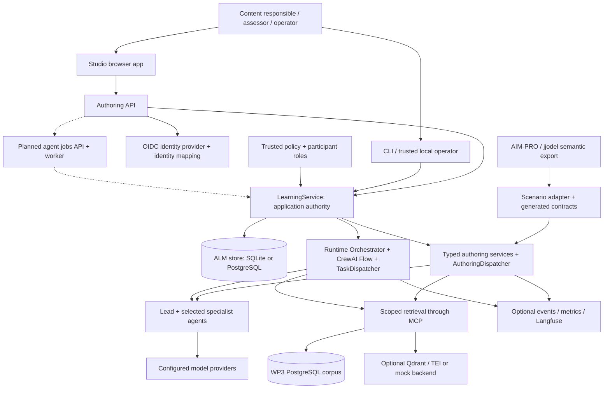
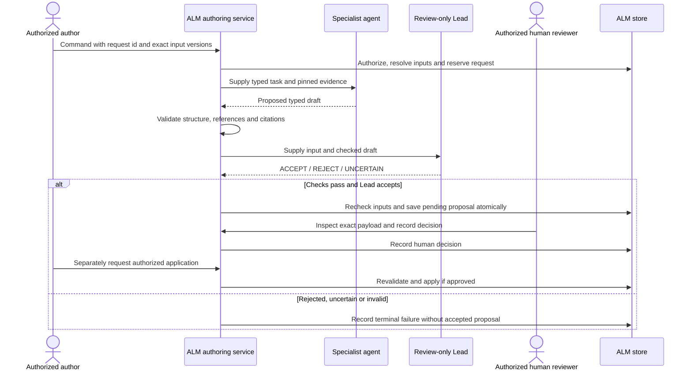
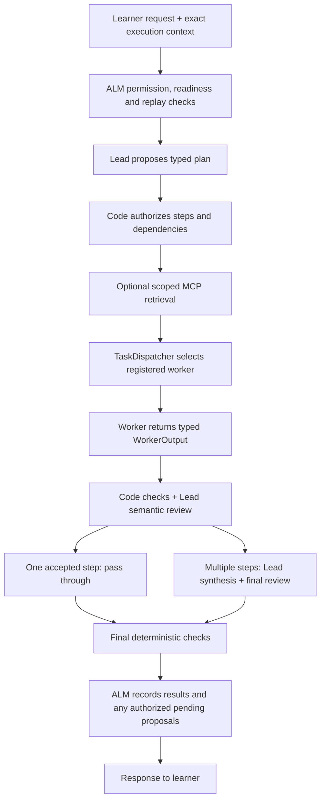

# ALM prototype: capabilities, agents and architecture

Working draft, 9 November 2026. Audience: project collaborators who need an
overview before reading the detailed implementation guides. This document
describes the current repository and identifies planned or incomplete boundaries;
it does not authorize a release, deployment or learner pilot.

## 1. Purpose and scope

The system supports the design and controlled delivery of learning paths. It
combines AIM-PRO scenario input, source-backed content generation, human review,
versioned learning definitions and recorded learner interactions.

There are two distinct modes:

- **PREPARATION:** propose a syllabus, assessments and teaching/practice materials;
  review the exact artifacts and prepare a frozen release.
- **LEARNING:** use an authorized delivery context to explain, guide practice,
  ask Socratic questions and work with actual learner evidence.

Agents propose content and judgments. The ALM application controls permissions,
validation, persistence and state transitions. A model verdict is not a human
approval, and a successful interaction is not proof of competency acquisition.

## 2. People and responsibilities

| Actor | Responsibility |
| --- | --- |
| Content responsible / teacher | Review sources, syllabus, assessments and materials; approve or request revisions within assigned authority. |
| Assessor | Review proposed evaluations against actual evidence and the applicable assessment criteria. |
| Administrator / operator | Configure contexts, participants, trusted policies and infrastructure; perform authorized operational steps. |
| Learner | Request authorized assistance and submit work; inspect the learning records visible to that learner. |

These are application responsibilities, not LLM agent names. The trusted policy
and participant roles determine authority. An identity-provider login alone
does not grant content or assessment permissions.

## 3. System capabilities

| Capability | Current behavior and boundary |
| --- | --- |
| Scenario intake | Read a jjodel semantic export, select an iSQD scenario and competency catalogue, resolve referenced objects and report diagnostics. Source models remain unchanged. |
| Source preparation | Search an authorized corpus scope, retain exact resource versions and excerpts, and prepare explicit source selections and coverage requirements. |
| Syllabus authoring | Curator proposes ordered units, targets, intended activities, citations and gaps; Lead reviews the typed result. |
| Assessment authoring | Evaluator proposes concrete assessment items, required evidence, stimuli and analytic rubrics from the approved syllabus. |
| Teacher authoring | Generate explanations, examples and transcripts from approved syllabus and assessment inputs; a structured component variant is also available. |
| Trainer authoring | Generate practice instructions and worksheets; optionally reuse explicitly selected approved Teacher assets. |
| Project versioning | Select exact artifact versions, preserve review receipts, track dependencies and detect stale dependent content. |
| Human review | Inspect exact proposals; record APPROVE, REJECT or REQUEST_REVISION. Applying an approved proposal is a separate operation. |
| Release and delivery | Propose and review a frozen release, import it into a separate delivery context, configure resource bindings and policy, and propose activation separately. |
| Learner assistance | Plan and execute authorized explanation, practice, support-summary and Socratic tasks through CrewAI Flow. |
| Evidence and evaluation | Record actual submissions and support reviewed evaluation state changes. A complete production assessor-facing runtime adapter remains pending. |
| Inspection and audit | Inspect context/project/release state, replay completed requests, retain historical references and export a read-only AIM-PRO-linked execution trace. |
| Observability | Optional structured event logs, derived metrics and Langfuse tracing with mode-specific content handling. |
| Application access | CLI plus authenticated Authoring API reads, decisions and application. The Studio shell exists; its review interface is under local development at this checkpoint. |

## 4. Architecture and component boundaries

Solid edges show existing integration paths. Dashed edges show planned application
job execution. The two database nodes have different responsibilities even when
both use PostgreSQL.



The current API exposes inspection, review and application through
`LearningService`; its service construction refuses agent execution. Generation
and learner orchestration are currently reached through the CLI/service paths.
The diagram's API-to-service edge does not expose every service method over HTTP.
An asynchronous API job/worker boundary is planned, not delivered by the existing
agent dispatchers.

The store preserves versioned entities, context revisions, requests and applied
operations. WP3 supplies source documents; it is not the learning-state store.
Retrieval is performed by application control and supplied to agents as evidence.
Workers have no direct database or search tools and cannot delegate recursively.

Implementation: [service](../../learning/service.py),
[store](../../learning/store.py), [builders](../../main.py),
[application/API boundaries](role-applications.md),
[WP3 retrieval](../wp3/integration.md).

## 5. Agent catalogue

An agent is a configured role, prompt and model profile, not necessarily a
separate process or a different model. Registration alone does not cause execution.

### 5.1 Lead

The [Lead](../../control/lead.md) has no tools and no automatic delegation.
In learner orchestration it proposes a typed plan, reviews worker results and,
when multiple steps produce a response, synthesizes the accepted results and
reviews the final synthesis. In dedicated authoring, a separately constructed
review-only Lead judges the specialist's checked draft.

Planning, review and synthesis remain Lead responsibilities in the current
design. They use distinct prompts and structured contracts; there is no planned
refactoring implied by this document.

### 5.2 Dedicated authoring agents

These agents have a separate registry under `agents/authoring/`.

| Educational role | Dispatcher name | Output |
| --- | --- | --- |
| Curator | `syllabus-designer` | `SyllabusDraft`: ordered units, intents, citations and gaps. |
| Evaluator | `assessment-designer` | `AssessmentDraft`: assessment items, evidence requirements, stimuli and criterion-specific rubric levels. |
| Teacher | `teaching-designer` | `TeacherDraft`: instructional items and complete explanation/example/transcript assets. |
| Teacher, structured variant | `teaching-designer-structured` | `StructuredTeacherDraft`: typed components rendered by application code. |
| Trainer | `practice-designer` | `TrainerDraft`: practice items, worksheets and supporting assets. |

The authoring Evaluator designs assessments. It does not evaluate a learner who
has not submitted evidence. These outputs become pending proposals only after
the relevant deterministic checks and an acceptable Lead review.

### 5.3 Educational workers in the general registry

| Mode | Role | Registry name | Assigned function |
| --- | --- | --- | --- |
| LEARNING | Teacher | `lesson-explainer` | Explain an approved topic with sources. |
| LEARNING | Trainer | `guided-practice-coach` | Give formative feedback on actual supplied work and guide the next practice step. |
| LEARNING | Socratic | `reasoning-questioner` | Ask a constructive question or give a limited hint without revealing the solution. |
| LEARNING | Curator | `lesson-support-summarizer` | Summarize approved sources into learner-visible support material. |
| LEARNING | Evaluator | `learner-response-evaluator` | Assess actual supplied evidence against explicit criteria; the assessor-facing production workflow is incomplete. |
| PREPARATION | Curator | `resource-candidate-researcher` | Propose candidate resources from an authorized source scope. |
| PREPARATION | Evaluator | `assessment-designer` | Propose an assessment design through the general worker contract. |

The two `assessment-designer` entries belong to different registries and output
contracts. Dedicated project generation uses the authoring registry, not the
general worker definition.

Eligibility also requires an active `AgentSpecialization`, matching category,
compatible mode, declared skills and authorization. An agent file alone does
not make that agent available in a learning context.

### 5.4 Auxiliary configurations outside the standard educational path

The general registry also contains `requirements-analyst`, `execution-planner`,
`technical-document-researcher`, `policy-procedure-researcher`, `answer-reviewer`
and `answer-synthesizer`. They are loadable configurations, but lack the category
required by the current educational specialization selector. They are not
automatically selected in the standard flow; direct dispatcher exercise in tests
does not establish a production integration.

In particular, `answer-reviewer` and `answer-synthesizer` do not perform the
current orchestration review/synthesis calls. The Lead performs those calls.

## 6. Agent contracts

An agent does not enforce its own contract. Its prompt describes the task, but
host code checks every layer below and refuses an output that does not match,
before anything reaches a person. A refusal is a fixed check code or text; model
text never becomes an error message. All typed contracts are frozen Pydantic
records with extra fields forbidden (`Record` in
[learning/contracts.py](../../learning/contracts.py)).

| Layer | Defined in | Checked | Fixes |
| --- | --- | --- | --- |
| 1. Configuration | agent file front matter and its category file | when the registry loads | category, mode, output kind, tools, skills, model profile |
| 2. Task | `ROLE_CONTRACTS`, the authoring dispatcher's contracts | for each plan step or authoring call | which intent and output kind a role may take in this context |
| 3. Output type | typed records, one per agent | on the model's response | the shape of what the agent may return |
| 4. Content checks | `learning/outputs.py`, `checked_syllabus`, `checked_draft` | after parsing | references, citations, coverage, completeness |
| 5. Review verdict | `SemanticReview`, `SyllabusVerdict`, `GenerationVerdict` | after the checks | the Lead's judgment of the checked output |

### 6.1 Configuration contract

Each agent is a Markdown file whose front matter is parsed into `AgentConfig`
([agent_system/config.py](../../agent_system/config.py)); unknown fields are
refused.

| Field | Values | Rule |
| --- | --- | --- |
| `name`, `description` | text | unique within its registry |
| `profile` | a model profile of `runtime.properties` | must exist |
| `category` | `teacher`, `trainer`, `socratic`, `evaluator`, `curator` | must name a file in `categories/` |
| `mode` | `LEARNING`, `PREPARATION` | given together with `expected_output`, and only with a `category` |
| `expected_output` | `EXPLANATION`, `GUIDED_PRACTICE`, `SUPPORT_MATERIAL`, `ASSESSMENT`, `SOCRATIC_TURN`, `CHANGE_PROPOSAL` | the one output kind the agent produces |
| `tools` | `search_documents` | only tools the category allows |
| `skills` | names under `skills/` | must exist |

The category file adds rules every agent of that category inherits: its
`allowed_tools`, its `required_tools` and `required_skills` (added to the agent),
its generation settings, and a category prompt placed before the agent's own
prompt (`CATEGORY … SPECIALIZATION …`).

| Category | Temperature | Required skills | Allowed tools |
| --- | --- | --- | --- |
| `curator` | 0.2 | `evidence-search` | `search_documents` |
| `evaluator` | 0.1 | none | `search_documents` |
| `socratic` | 0.3 | none | `search_documents` |
| `trainer` | 0.4 | none | `search_documents` |
| `teacher` | 0.6 | none | `search_documents` |

The [Lead](../../control/lead.md) is refused at load if it has a category or
tools, and it cannot be registered as a worker.

### 6.2 Task contract

**Learning flows.** A worker runs only through an active `AgentSpecialization`
of the context that names it (`registryName`) with its role, category, topics
and skills. The role fixes the intent and the output kinds
(`ROLE_CONTRACTS` in [learning/planning.py](../../learning/planning.py)):

| Role | Intent | Output kinds |
| --- | --- | --- |
| TEACHER | `EXPLAIN` | `EXPLANATION` |
| TRAINER | `PRACTICE` | `GUIDED_PRACTICE` |
| CURATOR | `CURATE` | `SUPPORT_MATERIAL`; `CHANGE_PROPOSAL` in PREPARATION only |
| EVALUATOR | `ASSESS` | `ASSESSMENT`, `CHANGE_PROPOSAL` |
| SOCRATIC | `SOCRATIC_GUIDANCE` | `SOCRATIC_TURN` |

Code authorizes each step of the Lead's plan: the worker's `mode` and
`expected_output` match the context mode and the step; the requested topics,
outcomes and activities lie within the specialization; each activity has the
task's intent and is ready; retrieval is only `search_documents`, read-only,
within the specialization's grants and the context policy's scope; and a
Socratic request is never served by a non-Socratic step.

**Authoring.** The `AuthoringDispatcher`
([agent_system/authoring.py](../../agent_system/authoring.py)) registers, for
each authoring agent, a category and one output type. It refuses an agent that
is not `PREPARATION` with `CHANGE_PROPOSAL`, has another category, declares a
tool other than `search_documents` or an unknown skill. The agent is then built
with no tools and no delegation: retrieval is done by the host, and the agent
receives only the evidence it is given. A prompt over the context budget of a
local profile is refused.

### 6.3 Output contracts: what each agent may return

This is the part that fixes what an agent can generate. Anything outside its
type is refused when the response is parsed.

| Agent | Output type | Content | Limits |
| --- | --- | --- | --- |
| Lead, planning | `LearningPlanDraft` | steps: agent, task, intent, output kind, activities, coverage, dependencies, optional retrieval | maximum step count, unique ids, no cycles; retrieval `k` 1–20 |
| Lead, review | `SemanticReview` | `ACCEPT`, `REJECT` or `UNCERTAIN`, and a reason | |
| Lead, synthesis | `LearningResponse` | content, citations, coverage | never `PROPOSAL`, proposal or state references, or a claim of application |
| Learning workers | `WorkerOutput` | kind, content, citations, coverage, findings, proposals | proposals only from a Curator or Evaluator, never with `SUPPORT_MATERIAL` |
| `syllabus-designer` | `SyllabusDraft` | units: title, source target, competencies, practices, purpose, planned intents (`EXPLAIN`, `PRACTICE`, `ASSESS`), corpus citations; gaps | 1–96 units |
| `assessment-designer` | `AssessmentDraft` | `ASSESS` items per unit: format, outcomes, evidence kind and requirement, rubric criteria, stimuli, citations; gaps | 1–96 units; up to 16 criteria, each with 2–8 levels |
| `teaching-designer` | `TeacherDraft` | `EXPLAIN` items per unit and their materials (`EXPLANATION`, `TRANSCRIPT`, `EXAMPLE`); gaps | 1–96 units, up to 288 materials |
| `teaching-designer-structured` | `StructuredTeacherDraft` | typed components (explanations, prompt comparisons, peer examples, transcripts) that the host renders into a `TeacherDraft` | the schema is stated in the prompt and the returned text is validated unchanged |
| `practice-designer` | `TrainerDraft` | `PRACTICE` items per unit with `WORKSHEET` materials, optionally reusing selected Teacher materials; gaps | 1–96 units, up to 288 materials |

Every authoring citation is a `CorpusCitation`: resource id and version, the
excerpt (document) ids, and the claim they support. Every generated draft echoes
the `input_digest` of the exact host input it was given.

The review agent answers authoring drafts with its own typed verdict:
`SyllabusVerdict` (verdict, `source_alignment`, `citation_support`, reason) for
the Curator, and `GenerationVerdict` (the same plus `intent_correct` and
`content_complete`) for the Evaluator, Teacher and Trainer. A draft is accepted
only with `ACCEPT` and every flag true.

### 6.4 Content checks

**Learning worker output** (`worker_output_violation` in
[learning/outputs.py](../../learning/outputs.py)):

| Code | Refused when |
| --- | --- |
| R18 | the kind is not the task's expected output, or the Lead's review is not `ACCEPT` |
| R09 | a citation is not a permitted `Resource` retrieved for this task |
| R07 | coverage goes beyond the assigned coverage, or omits part of it without a finding |
| R16 | proposals come from a role other than Curator or Evaluator, or with `SUPPORT_MATERIAL` |

The final response is refused when it is a `PROPOSAL`, carries proposal or state
references, claims an application, or cites sources or coverage that no
accepted step produced.

**Syllabus** (`checked_syllabus` in [aimpro/syllabus.py](../../aimpro/syllabus.py)):
the source fingerprints match; the units cover exactly the supplied targets,
with unique keys; each unit's competencies and practices come from its own
target; planned intents are not repeated; every citation lies within the
retrieved resource versions and excerpts.

**Evaluator, Teacher and Trainer drafts** (`checked_draft` in
[aimpro/generators.py](../../aimpro/generators.py)):

- the exact output type and the host's `input_digest`;
- the units are exactly the target units (of the block being written);
- every item's outcomes belong to its unit, and the items cover every approved
  outcome of the unit;
- every citation lies within the supplied source versions and excerpts;
- assessments: rubric criteria cover every item outcome; each level descriptor
  has at least five words, is distinct and is not a generic label such as
  "developing"; every required stimulus is present with its kind;
- Teacher items reference an explanation, a transcript and an example; Trainer
  items a worksheet; referenced materials exist, shared materials come only
  from the selected Teacher content, and every material serves an item;
- a structured Teacher draft must render exactly as the host renders it.

### 6.5 Review and retries

An authoring draft goes to the review agent only after it passes the checks.
At most three drafts are written per request (`ATTEMPTS`, D30); a refused draft
goes back to the agent with its own output and the reason, as untrusted data.
Since S09d the Evaluator, Teacher and Trainer write a syllabus in blocks of at
most 12 units (`BLOCK_UNITS`), each drafted, checked and reviewed on its own,
then assembled, checked and reviewed once more; the structured Teacher still
writes the whole request in one response. Every draft's assessment is kept with
the request. In learning flows a refused worker output is not retried.

### 6.6 What no contract allows

Whatever its configuration, no agent can:

- write to the ALM store, change permissions or policy, approve or apply a
  proposal, or approve a binding;
- mark a competency acquired, verified or completed, or evaluate a learner who
  has not submitted evidence;
- call another agent (delegation is off) or use a tool other than read-only
  `search_documents`; authoring agents run with no tools at all;
- follow instructions found in sources, schemas, quoted text or other agents'
  output, which are untrusted data;
- in Socratic mode, reveal the solution or an equivalent hint, including through
  citations.

## 7. Authoring interactions and artifact dependencies

Arrows in this diagram mean **consumes an exact approved artifact**, not direct
agent-to-agent messaging. Application services resolve and pass the inputs.

```mermaid
flowchart LR
    Source["Scenario + authorized source snapshot"]
    Curator["Curator"]
    Syllabus["Approved syllabus"]
    Evaluator["Evaluator authoring"]
    Assessment["Approved assessment package"]
    Teacher["Teacher authoring"]
    Teaching["Approved Teacher package"]
    Trainer["Trainer authoring"]
    Practice["Approved Trainer package"]

    Source --> Curator
    Curator -->|"Review, approval, application"| Syllabus
    Syllabus --> Evaluator
    Evaluator -->|"Review, approval, application"| Assessment
    Syllabus --> Teacher
    Assessment --> Teacher
    Teacher -->|"Review, approval, application"| Teaching
    Syllabus --> Trainer
    Assessment --> Trainer
    Teaching -.->|"Optional explicit shared input"| Trainer
    Trainer -->|"Review, approval, application"| Practice
```



Every dedicated generation follows the same responsibility boundary:



Teacher/Trainer project generation consumes selected source excerpts already
retained with the approved syllabus; it does not silently run a fresh corpus
search. Replacing an assessment makes content that consumed its old version
stale. Reusing Teacher assets adds a Trainer dependency on that Teacher version.
Stale selections block release; historical versions remain intact.

Details: [authoring lifecycle](authoring-lifecycle.md),
[projects](authoring-projects.md), [generators](authoring-generators.md).

## 8. Learner interaction flow



The diagram shows the successful path. Invalid plans or results are refused.
Each request creates a fresh CrewAI Flow, which executes steps in dependency
order. A failed step causes its dependants to be skipped; independent steps can
continue. Rejected worker outputs are not automatically retried. An identical
completed request is replayed without constructing models again, subject to the
service's authorization and context checks.

The Lead sees only eligible specialists. Workers cannot choose permissions,
approve bindings, change the database or mark a competency acquired. A learner's
permission to interact does not imply permission to persist an evaluation
proposal. Only accepted results contribute to the final answer.

Implementation: [orchestrator](../../agent_system/orchestrator.py),
[plan authorization](../../learning/planning.py),
[worker dispatcher](../../agent_system/dispatch.py),
[output checks](../../learning/outputs.py).

## 9. Release, delivery and learning state

The lifecycle separates content approval from permission to use that content
in a particular delivery:

```text
Reviewed authoring project
  -> proposed release -> human decision -> application
  -> proposed delivery import -> human decision -> application
  -> destination policy installation and approved resource bindings
  -> proposed activation -> human decision -> application
  -> authorized learner interactions and observed submissions
  -> separately proposed, reviewed and applied evaluations
```

A release pins exact compatible artifact versions. A delivery stays on its
imported release; a later authoring revision does not rewrite its past evidence
or assessment criteria. Current import/activation operations refuse destinations
that already hold learner history. Upgrading an active delivery requires a
separately designed migration.

Completion, acquisition and verification require explicit reviewed rules and
applicable evidence. Generators do not infer them. Activation is refused when
an imported ASSESS activity lacks the required runtime role. See
[release/import contracts](releases.md).

## 10. Reuse across scenarios and model boundaries

The orchestration and ALM lifecycle are reusable across scenario instances.
`--scenario`, `--competencies` and, when needed, `--root-id` select the source
objects; SCN01 and its catalogue are defaults, not mandatory instance names.

The current AIM-PRO integration is nevertheless structure-dependent: it expects
a `jjodel-megamodel` 1.0 semantic export, an `iSQD.Scenario` root and learning
targets with explicit competencies and practices. The separate `Scenario`
package is not an interchangeable input contract. A different metamodel or
unsupported type declaration can require adapter and mapping work.

SCN01 has documented real source-backed authoring runs and human decisions.
The locally prepared [LPO-AI example](../../examples/lpo-ai/README.md) documents
a second, offline-checked scenario design; it is not an executed ALM release or
evidence of a complete second-scenario generation/delivery run. Some prompts
retain workshop-oriented wording. A new scenario needs appropriate sources,
reviewed configuration and its own validation of generation quality and fit.

ALM execution state remains separate from the externally owned AIM-PRO export.
The read-only trace links them; it does not establish complete native AIM-PRO
runtime convergence. See [the decision register](agentic-network-decisions.md).

## 11. Evidence, maturity and follow-up

| Area | Evidence / current limit |
| --- | --- |
| Real authoring | SCN01 reports document Curator inputs and Evaluator/Teacher/Trainer generation, Lead review, human decisions and application. Approved content has not been validated with learners. |
| Lifecycle integration | `tests/test_authoring_cycle.py` exercises the production lifecycle with synthetic model/retrieval responses, including version changes and historical delivery preservation. |
| Orchestration | `tests/test_orchestration_flow.py` covers fresh Flow state, dispatch and guarded output behavior. This is not a model-quality benchmark. |
| Release/import | Production commands exist and have synthetic acceptance coverage. Their existence does not establish an approved real SCN01 delivery. |
| API and identity | Authoring reads, decisions and application exist, with service-parity and stale-review checks. Learner API and asynchronous agent jobs remain planned. |
| Browser review | Local Studio review work is present but uncommitted at this checkpoint; no pilot or deployed-interface acceptance is implied. |
| Runtime assessment | The worker definition and evaluation checks exist; a complete assessor-facing production adapter remains pending. |

Next documentation increments should add one concrete walkthrough with exact
inputs and artifacts, a deployment view once the job worker is implemented, and
measured second-scenario results. Keep implementation evidence distinct from
pedagogical validation and stakeholder decisions.
