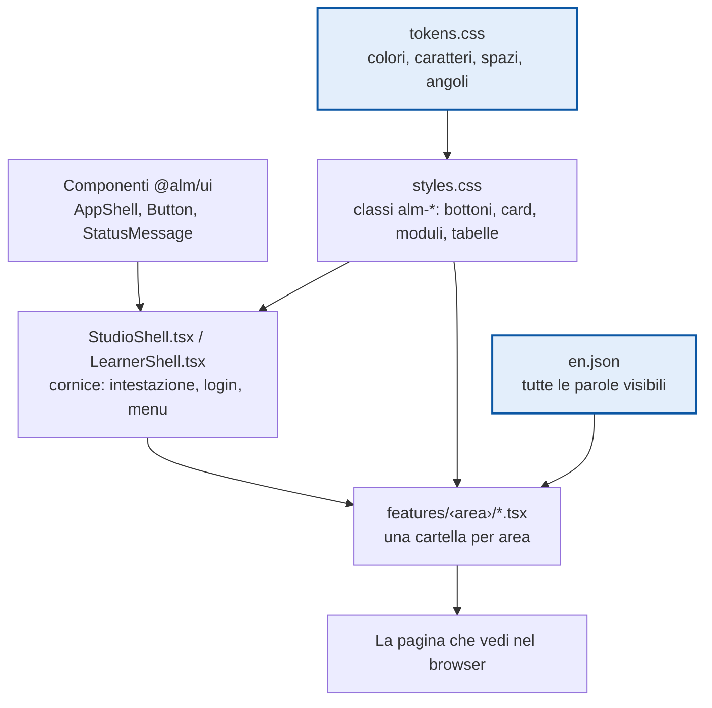
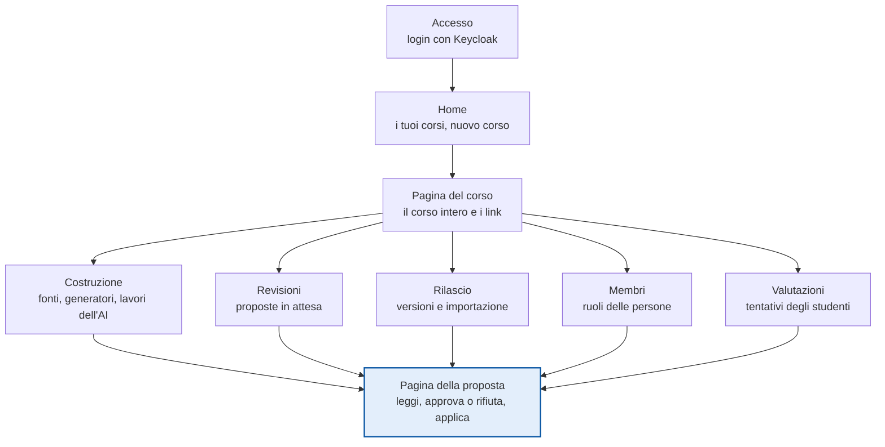
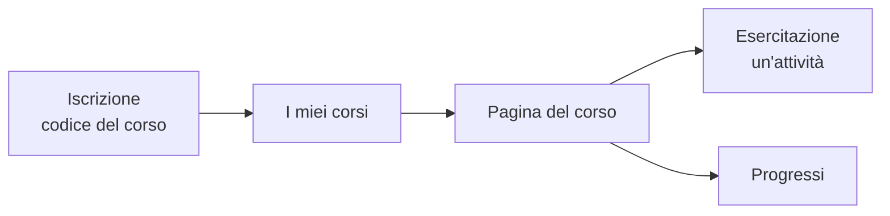

# Guida al frontoffice: avviarlo e modificarlo

Guida in italiano per chi modifica l'aspetto delle applicazioni web (colori, caratteri, layout, testi) senza conoscere il codice nel dettaglio.

## Introduzione

Il frontoffice è composto da due applicazioni web che condividono lo stesso design system:

- **ALM Studio** (`apps/studio`): la usano docenti e formatori per creare un corso, farlo revisionare, rilasciarlo ed erogarlo.
- **App dello studente** (`apps/learner`): la usano gli studenti per entrare in un corso con il suo codice, seguirlo, esercitarsi e vedere i propri progressi.

| Livello | Tecnologia | Cosa significa per chi modifica |
| --- | --- | --- |
| Schermate | React 19 + TypeScript (file `.tsx`) | Ogni pagina è un componente che scrive markup simile all'HTML, con classi CSS |
| Server di sviluppo | Vite 8 | Quando salvi un file, il browser si aggiorna da solo |
| Stile | CSS puro con variabili (`--alm-…`) | Niente Tailwind, Sass o librerie: cambi una variabile e cambiano tutte le pagine di entrambe le app |
| Design system | Pacchetto `@alm/ui` in `apps/packages/ui` | Token, stili di base, `Button`, `StatusMessage`, cornice della pagina |
| Testi | i18next, un catalogo `en.json` per app | Tutte le parole visibili stanno in un file JSON |
| Navigazione | React Router | Associa ogni indirizzo a una pagina |
| Controlli | Vitest, Playwright, axe | Contrasto colori, focus e accessibilità verificati in automatico (WCAG 2.1 AA) |

La guida segue l'ordine in cui lavorerai: avviare l'interfaccia, capire come è fatta, modificarla, verificare e consegnare. Le app oggi sono solo in inglese, quindi i loro testi restano in inglese anche se questa guida è in italiano.

## Avviare l'interfaccia

Per vedere le app con dati veri servono tre pezzi in esecuzione: Keycloak per il login, le API con un database di esempio, e le app in modalità sviluppo. Bastano due terminali, tre se lavori anche sull'app dello studente.

**Prerequisiti, una volta sola.** Git, Node 26.13 o successivo, Python 3, Docker Desktop (Compose 2.20.3 o successivo) e un editor come VS Code. Poi, dalla cartella del repository:

```sh
python3 -m venv .venv
source .venv/bin/activate
python -m pip install -r requirements.txt
cd apps && npm ci --ignore-scripts
```

**Password locali, una volta sola.** Crea il file `~/.alm-dev.env` con tre valori fissi a tua scelta, così non cambiano a ogni avvio:

```sh
export ALM_KEYCLOAK_ADMIN_PASSWORD=admin-locale-123
export ALM_KEYCLOAK_DEV_PASSWORD=dev-locale-123
export ALM_OIDC_CLIENT_SECRET=segreto-locale-123
```

**Terminale 1: login, API e dati di esempio.** Dalla cartella del repository:

```sh
source ~/.alm-dev.env
docker compose -f compose.identity.yml up -d --wait
cd apps && node e2e/stack/api.mjs
```

Lo script `e2e/stack/api.mjs` è lo stesso dei test automatici. Crea da zero un database di esempio e avvia l'API dello Studio (porta 58001), l'API dello studente (porta 58002) e un finto agente AI che risponde senza modelli né internet. A ogni avvio i dati tornano puliti.

**Terminale 2: lo Studio.**

```sh
cd apps && npm run dev --workspace @alm/studio
```

Apri `http://127.0.0.1:58000/studio/`, premi "Sign in" ed entra come `dev-admin` con la password `ALM_KEYCLOAK_DEV_PASSWORD`. C'è anche `dev-assessor` per vedere lo Studio con un altro ruolo. Il corso di esempio da aprire è `architecture-authoring`.

**Terminale 3, se serve: l'app dello studente.**

```sh
cd apps && npm run dev --workspace @alm/learner
```

Apri `http://127.0.0.1:58003/learn/` ed entra come `dev-learner`, con la stessa password.

**Per lavorare comodo:**

- Tieni editor e browser affiancati: quando salvi un file `.css`, `.json` o `.tsx`, la pagina si aggiorna da sola in meno di un secondo, senza perdere il login.
- Prova i colori nel browser prima di scriverli: strumenti per sviluppatori (Cmd+Opt+I), scheda Elements, seleziona `:root` e cambia le variabili `--alm-…`. Quando il risultato ti piace, copia i valori in `tokens.css`.
- Usa la modalità responsive degli strumenti per sviluppatori (Cmd+Shift+M) per vedere la pagina a 360px di larghezza.
- Se ti serve solo provare colori e caratteri, basta il terminale 2: senza API vedi la pagina di accesso e il messaggio "cannot reach the authoring service".

**Per spegnere tutto:** Ctrl+C in ogni terminale, poi `docker compose -f compose.identity.yml down`.

## La struttura

Ogni pagina nasce da tre fonti: lo stile condiviso, i componenti React e i testi. Se capisci dove sta ciascuna, sai dove mettere le mani. In evidenza i due file che modificherai più spesso.



Le frecce indicano chi usa cosa. Una variabile cambiata in `tokens.css` arriva a tutte le pagine di entrambe le app. Una classe cambiata in `styles.css` cambia quel componente ovunque. Un file in `features/` cambia una sola pagina.

| File | Percorso completo (da `apps/`) |
| --- | --- |
| tokens.css | `packages/ui/src/tokens.css` |
| styles.css | `packages/ui/src/styles.css` |
| Componenti @alm/ui | `packages/ui/src/AppShell.tsx`, `Button.tsx`, `StatusMessage.tsx` |
| Cornice | `studio/src/shell/StudioShell.tsx`, `learner/src/shell/LearnerShell.tsx` |
| Pagine | `studio/src/features/<area>/`, `learner/src/features/<area>/` |
| Testi | `studio/src/i18n/en.json`, `learner/src/i18n/en.json` |
| Indirizzi delle pagine | `studio/src/routes.tsx`, `studio/src/features/review/routes.tsx`, `learner/src/routes.tsx` |

## Il flusso

### Studio

L'utente entra, sceglie un corso dalla home e dalla pagina del corso raggiunge le aree di lavoro. Qualunque cosa cambi (sillabo, membri, rilascio, valutazione) diventa una proposta, che una persona legge, approva e applica.



La pagina della proposta è quindi la più visitata e la più importante da curare. Da lì si apre anche la modifica del sillabo, e dal rilascio si passa all'importazione in un corso di erogazione.

| Pagina | Indirizzo (dopo `/studio`) | File (da `apps/studio/src/`) |
| --- | --- | --- |
| Home | `/` | `features/home/HomePage.tsx` |
| Pagina del corso | `/contexts/<corso>/course` | `features/course/CoursePage.tsx` |
| Costruzione | `/contexts/<corso>/build` | `features/course-build/BuildPage.tsx` |
| Revisioni | `/contexts/<corso>/review` | `features/review/ReviewInboxPage.tsx` |
| Proposta | `/contexts/<corso>/review/<proposta>` | `features/review/ProposalPage.tsx` |
| Modifica sillabo | `/contexts/<corso>/review/<proposta>/edit` | `features/review/SyllabusEditPage.tsx` |
| Rilascio | `/contexts/<corso>/releases/<id>/versions/<versione>` | `features/release/ReleasePage.tsx` |
| Importazione | `/contexts/<corso>/import` | `features/delivery/ImportPage.tsx` |
| Membri | `/contexts/<corso>/members` | `features/members/MembersPage.tsx` |
| Valutazioni | `/contexts/<corso>/assessments` | `features/assessments/AssessmentsPage.tsx` |

Accesso e servizio non raggiungibile stanno in `features/session/`. Con i dati di esempio, prova `/contexts/architecture-authoring/course`.

### App dello studente

Lo studente entra con il codice del corso, poi da "I miei corsi" apre un corso, si esercita sulle attività e controlla i progressi.



| Pagina | Indirizzo (dopo `/learn`) | File (da `apps/learner/src/`) |
| --- | --- | --- |
| I miei corsi | `/` | `features/courses/MyCoursesPage.tsx` |
| Iscrizione | `/join` | `features/join/JoinPage.tsx` |
| Pagina del corso | `/courses/<corso>` | `features/course/CoursePage.tsx` |
| Esercitazione | `/courses/<corso>/activities/<attività>` | `features/practice/PracticePage.tsx` |
| Progressi | `/courses/<corso>/progress` | `features/progress/ProgressPage.tsx` |

## Come modificare

Parti sempre dal livello più alto possibile: prima i token, poi le classi condivise, e solo alla fine la singola pagina. Così una scelta di design resta coerente in tutte e due le app.

| Voglio cambiare… | File (da `apps/`) | Cosa fare |
| --- | --- | --- |
| Un colore del marchio | `packages/ui/src/tokens.css` | Sostituisci il valore esadecimale della variabile |
| Carattere o dimensioni del testo | `packages/ui/src/tokens.css` | `--alm-font-family`, `--alm-font-size`, `-small`, `-large` |
| Densità, margini, angoli | `packages/ui/src/tokens.css` | `--alm-space-1` … `-5`, `--alm-radius` |
| L'aspetto di un componente ovunque | `packages/ui/src/styles.css` | Modifica le regole della classe (`.alm-card`, `.alm-button`…) |
| Una parola, un titolo, un messaggio | `studio/src/i18n/en.json` o `learner/src/i18n/en.json` | Modifica solo il testo a destra dei due punti |
| Il layout di una sola pagina | `studio/src/features/<area>/…Page.tsx` o `learner/src/features/<area>/…Page.tsx` | Sposta il markup, cambia le classi |

I token principali e i loro valori attuali:

| Token | Valore | Dove si vede |
| --- | --- | --- |
| `--alm-color-text` | `#1b1f24` | Testo |
| `--alm-color-text-muted` | `#4a5360` | Testo secondario (`alm-muted`) |
| `--alm-color-background` | `#ffffff` | Sfondo della pagina |
| `--alm-color-surface` | `#f3f5f7` | Intestazione, pannelli |
| `--alm-color-border` / `-border-strong` | `#d0d5dc` / `#6b7685` | Divisori / bordi dei campi |
| `--alm-color-accent` / `-accent-hover` | `#0b57a4` / `#08457f` | Bottoni principali |
| `--alm-color-on-accent` | `#ffffff` | Testo sui bottoni principali |
| `--alm-color-link` | `#0b57a4` | Link |
| `--alm-color-focus` | `#1a56db` | Contorno del focus da tastiera |
| `--alm-color-danger` / `-danger-surface` | `#b42318` / `#fdecea` | Errori |
| `--alm-font-size` / `-small` / `-large` | 1rem / 0.875rem / 1.5rem | Testo / note / titoli di pagina |
| `--alm-space-1` … `-5` | 0.25 / 0.5 / 1 / 1.5 / 2.5rem | Spaziature |
| `--alm-radius` | 0.375rem | Angoli arrotondati |
| `--alm-content-width` | 72rem | Larghezza massima della pagina |

**Regole da rispettare:**

- Scrivi i colori sempre nel formato `#rrggbb` a sei cifre: il test del contrasto legge solo quello.
- Se cambi `--alm-color-accent`, aggiorna anche `-accent-hover` e `--alm-color-link`, così bottoni e link restano coerenti.
- Nelle classi usa i token (`var(--alm-space-3)`) e non valori fissi: un cambio futuro dei token le raggiungerà.
- Lascia `--alm-target-size` ad almeno 2.75rem: è la dimensione minima di tutto ciò che si clicca.
- Nei file `.tsx` non scrivere testo visibile: aggiungi una chiave in `en.json` e leggila con `t('area.chiave')`. Un test blocca il testo scritto direttamente.
- Le classi nuove vanno in `styles.css`, mai in un attributo `style="…"`.
- Le classi seguono lo schema `alm-blocco`, `alm-blocco__parte`, `alm-blocco--variante`.
- Un cambio in `tokens.css` o `styles.css` si vede in entrambe le app: controllale tutte e due.

Oggi le app non hanno logo, icone, immagini, web font né tema scuro: l'intestazione mostra il nome come testo. Aggiungerli è un lavoro nuovo, da concordare con uno sviluppatore (va scelto dove ospitare i file e il testo alternativo va in `en.json`).

## Esempio completo: la home dello Studio a schede

Obiettivo: oggi la home dello Studio elenca i corsi come un semplice elenco puntato. Li trasformiamo in schede affiancate, con il nome del corso in evidenza e un'introduzione più grande. Servono tre file: il CSS condiviso, la pagina e i testi.

**Passo 1. Apri la pagina nel browser.** Con lo stack avviato, vai su `http://127.0.0.1:58000/studio/`. Sotto "Your courses" vedi l'elenco puntato dei corsi di esempio.

**Passo 2. Aggiungi due classi in `packages/ui/src/styles.css`.** Le classi `alm-cards` e `alm-card` esistono già e sono usate dalla pagina del corso. Aggiungi una variante a griglia e uno stile per il titolo della scheda, subito sotto la regola `.alm-card > p`:

```css
.alm-cards--grid {
  grid-template-columns: repeat(auto-fill, minmax(18rem, 1fr));
  gap: var(--alm-space-3);
}

.alm-card__title {
  font-weight: 600;
  font-size: 1.125rem;
}
```

`auto-fill` con `minmax` mette tante schede quante ne stanno nella riga e su telefono scende a una colonna, senza media query.

**Passo 3. Usa le classi nella pagina `studio/src/features/home/HomePage.tsx`.** Nel componente `CourseItem` cambiano due righe.

Prima:

```tsx
<li>
  <p><Link to={coursePath(course.context_id)}>{course.context_id}</Link></p>
```

Dopo:

```tsx
<li className="alm-card">
  <p className="alm-card__title"><Link to={coursePath(course.context_id)}>{course.context_id}</Link></p>
```

Più in basso, nel componente `CourseList`, l'elenco riceve le due classi. Lascia com'è `data-testid`: i test automatici trovano l'elenco grazie a quello.

Prima:

```tsx
<ul data-testid="course-list">
```

Dopo:

```tsx
<ul className="alm-cards alm-cards--grid" data-testid="course-list">
```

Infine, nel componente `HomePage`, l'introduzione diventa più grande con la classe esistente `alm-lead`:

```tsx
<p className="alm-lead">{t('home.intro')}</p>
```

**Passo 4. Cambia il testo in `studio/src/i18n/en.json`.** Cerca la chiave `"intro"` dentro `"home"` e cambia solo il valore:

```json
"intro": "Pick a course to continue, or start a new one below.",
```

**Passo 5. Guarda il risultato.** Il browser si è già aggiornato: i corsi sono schede con bordo e angoli arrotondati, il nome in grassetto e i dettagli sotto in grigio. Stringi la finestra fino a 360px e controlla che le schede vadano una sotto l'altra.

**Passo 6. Verifica.** In `apps/` lancia `npm test` e `npm run typecheck`. Se sono verdi, la modifica è pronta per la pull request (sezione successiva).

Lo stesso schema vale per qualsiasi pagina, anche dell'app dello studente: trova il file nelle tabelle del flusso, riusa le classi esistenti, aggiungi in `styles.css` solo quello che manca e metti le parole in `en.json`.

## Verificare e consegnare

Prima di consegnare lancia `npm test` e `npm run typecheck` nella cartella `apps/`. Ci mettono pochi secondi e trovano da soli gran parte degli errori di design.

| Controllo automatico | Cosa verifica | Se fallisce |
| --- | --- | --- |
| Contrasto (`packages/ui/test/tokens.test.ts`) | 14 coppie di colori: testo su sfondo almeno 4.5:1, focus e bordi dei campi almeno 3:1 | Il messaggio indica la coppia: scurisci il testo o schiarisci lo sfondo |
| Focus | Bottoni, link e skip link mantengono il contorno di 3px nel colore `--alm-color-focus` | Non togliere né nascondere le regole `outline` |
| Movimento ridotto | `styles.css` mantiene il blocco `@media (prefers-reduced-motion: reduce)` | Non cancellarlo |
| Testi visibili (`apps/tests/user-visible-strings.test.ts`) | Nessun testo scritto direttamente nei file `.tsx` | Sposta il testo in `en.json` |
| Test nel browser (`npm run test:browser`) | Ogni pagina supera la scansione di accessibilità axe | Li lancia uno sviluppatore o la CI |

Controlla anche a mano nel browser:

- Premi Tab dall'inizio della pagina: il primo elemento è "Skip to main content" e ogni controllo mostra il contorno del focus.
- Stringi la finestra a 360px: niente scorrimento orizzontale, i bottoni vanno a capo senza sovrapporsi.
- Porta lo zoom al 200%: il testo va a capo e non viene tagliato.
- Invia un modulo vuoto per vedere gli errori nei colori `danger`.

**Consegnare con una pull request.** Ogni modifica entra nel ramo `main` tramite una pull request su GitHub, rivista prima del merge. Messaggi di commit e pull request vanno in inglese, come il resto del repository.

1. Crea un ramo da `main`: `git switch main && git pull && git switch -c design/home-cards`.
2. Fai le modifiche e lancia `npm test` e `npm run typecheck` in `apps/`.
3. Fai il commit con un messaggio breve, per esempio `git commit -am "Show the home course list as cards"`.
4. Pubblica il ramo (`git push -u origin design/home-cards`) e apri la pull request su GitHub, con screenshot prima e dopo.
5. Aspetta che i controlli della CI (`front-end` e `browser`) diventino verdi e che qualcuno approvi.

**Da non toccare senza uno sviluppatore:**

- `packages/api-client/src/generated/`: codice generato, viene sovrascritto.
- I file `.ts` (come `buildApi.ts`, `learnerApi.ts` o `model.ts`), i file `routes.tsx`, `packages/auth` e i `vite.config.ts`: gestiscono dati, login e indirizzi, non l'aspetto.
- Le chiavi di `en.json` (cambia solo i valori) e, nei `.tsx`, gli attributi `aria-*`, `role`, `id`, `htmlFor` e `data-testid`: collegano etichette e campi per i lettori di schermo e per i test.
- `services/`, `learning/` e le altre cartelle Python: è il backend.
